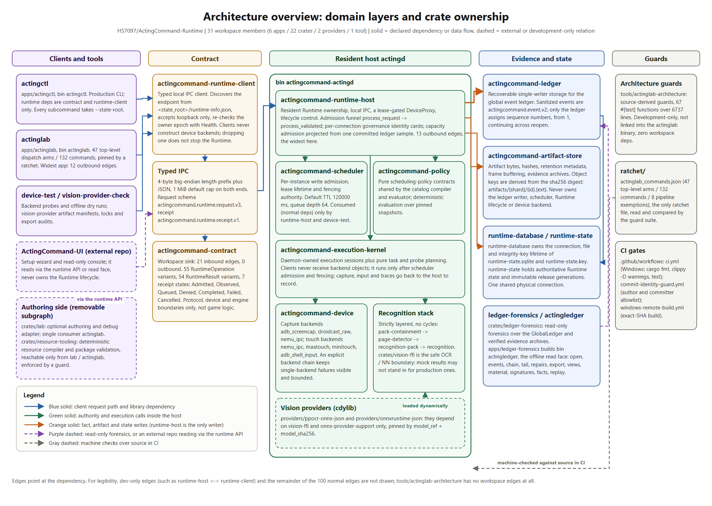
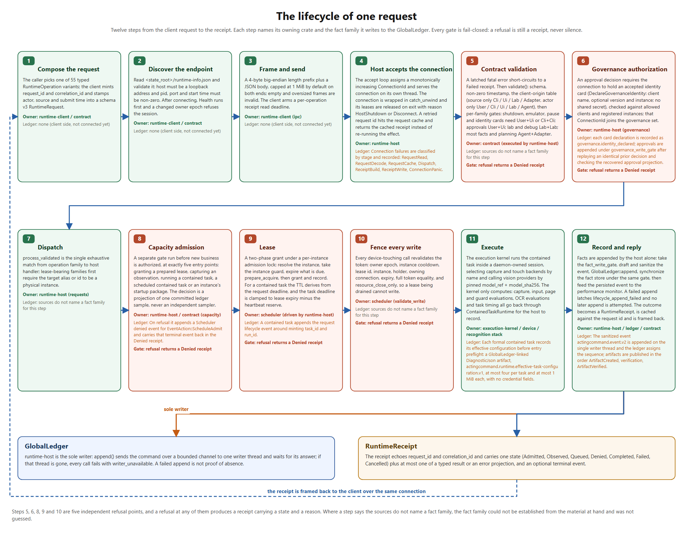
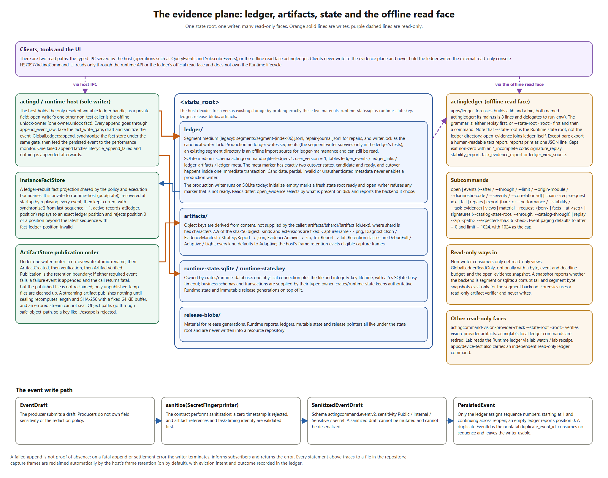

<p align="right">🌐 <b>English</b> · <a href="./README.zh-CN.md">简体中文</a></p>

<div align="center">


**Chief Executive Officer & Chairman** — HS7097<br/>
**Chief Technology Officer & Chief Architect** — Claude Opus 5.5 · GPT‑6 Astra · Claude Fable 5.1 · Claude Fable 5 · GPT‑5.5<br/>
**Board Secretary & Chief Audit Officer** — Claude Opus 5.5 · Claude Fable 5.1 · Claude Fable 5 · Claude Opus 4.8<br/>
**Principal Engineer** — Claude Opus 5.5 · GPT‑6 Astra · GPT‑5.6 Sol · GPT‑5.5<br/>
**Director of Fleet Operations** — GPT‑6 Astra<br/>
**Fleet Supervisor** — GPT‑5.6 Sol Daybreak · DeepSeek V4.1 Flash 1017

</div>

**⚠️ Pre-release, debug phase. Every release so far is a pre-release; interfaces, configuration and file formats still change, and only the latest release is supported. See [Development status](#development-status).**

# ActingCommand Runtime

ActingCommand Runtime is a resident Rust runtime for running multi-target automation on Android emulators and devices. The program core (Runtime, Tools and the MCP server) is neutral: it contains no logic or information about any concrete target — no names, pages, characters, stages, resources, values or rules. Code, contracts, defaults and fixtures are scanned in CI by the guard tests `c2_runtime_code_contracts_defaults_and_fixtures_are_project_neutral` and `r2f_product_and_authoring_paths_have_no_builtin_game_identity`. Everything specific to a target (screenshot material, recognition regions, click boxes, task order, data tables) lives in declarative resource packs: task packs, gathered per target into one standard pack, each named by its `package_id` and admitted structurally before loading; supporting another target means another pack, not another program. The runtime finds a pack by its path (`actingctl task-run --package <path>`) and takes no package digest. The GlobalLedger is the single source of truth, and only runtime-host holds a writable handle to it; a fact must be sanitized by the contract layer into `actingcommand.event.v3` before it may enter the ledger. Device access always goes through a lease granted by the scheduler, and every write revalidates the fence. The Runtime listens only on the local loopback address and contains no network code. Every boundary fails loud: invalid configuration, a non-loopback bind, stale evidence and incomplete exports all end in an explicit error or a nonzero exit rather than a silent downgrade, a refusal is a receipt too, and unknown is never treated as no.

[CI main status](https://github.com/HS7097/ActingCommand-Runtime/actions/workflows/ci.yml?query=branch%3Amain) (Windows: fmt / clippy `-D warnings` / seven module test jobs) · [Exact-SHA Windows build](https://github.com/HS7097/ActingCommand-Runtime/actions/workflows/windows-remote-build.yml) · [Releases](https://github.com/HS7097/ActingCommand-Runtime/releases) (on demand: Actions → release → Run workflow) · License `AGPL-3.0-only` · [Umbrella repository](https://github.com/HS7097/ActingCommand) · [UI console](https://github.com/HS7097/ActingCommand-UI)

## Repository family

| Repository | Role |
| --- | --- |
| [HS7097/ActingCommand](https://github.com/HS7097/ActingCommand) | Umbrella (portal) repository: the family README, the agent manual `skills/actingcommand/`, and the Releases page with the setup wizard, the member releases and the available standard packs |
| [HS7097/ActingCommand-Runtime](https://github.com/HS7097/ActingCommand-Runtime) | This repository: the resident runtime (daemon, CLI, MCP server, ledger, device backends) and the Tools (Lab, ledger reader, checks, watchdog launcher) |
| [HS7097/ActingCommand-UI](https://github.com/HS7097/ActingCommand-UI) | Setup wizard and monitoring console; talks to the runtime only through its API |

Components are released independently, each only when it has changed. Whether they fit together is decided by the interface revisions each one declares (`distribution/windows/component-interfaces.json`, `contracts/component-interfaces.md`), not by matching version numbers. Versions follow X (major or incompatible) . Y (new features or new coverage) . Z (fixes, including features that serve a fix).

## Current release

The current release is **v0.12.10** (pre-release) on this repository's [Releases](https://github.com/HS7097/ActingCommand-Runtime/releases) page. Every Release carries two zips and `SHA256SUMS`; the version exists only in the Release tag, and every file is bound to the exact source commit by its `BUILD-MANIFEST.json`.

| Zip | Layout | Contents |
| --- | --- | --- |
| `actingcommand-runtime-<sha>.zip` | `distribution-v1` | `actingcommand-actingd.exe`, `actingctl.exe`, `actingd.config.example.json`, `actingd.defaults.json` (the defaults the program embeds; a configuration names only the keys it changes), `INSTALL.md`, `RELEASE-NOTES.md` |
| `actingcommand-tools-<sha>.zip` | `platform-tools-v3` | `actinglab.exe`, `actingledger.exe`, `actingcommand-vision-provider-check.exe`, the watchdog launcher `actingwatch.exe`, and Google's official Android platform-tools 37.0.1 under `platform-tools/` (`adb.exe`, `AdbWinApi.dll`, `AdbWinUsbApi.dll`, `NOTICE.txt`, `source.properties`) |

Vision models and the ONNX Runtime never ship with a release: the OCR/NN engine is linked into `actingcommand-actingd.exe` and reads its models from `<vision root>\models\<model_ref>\`; without them, a target that needs OCR fails explicitly. `actingcommand-actingd.exe` also carries the official scrcpy server 5.0.1 and OpenH264 for the real-device capture backend; their notices are in RELEASE-NOTES.md.

v0.12.10 declares the interfaces `actingd-config` [5, 9], `install-selection` [1, 1], `install-control` [0, 1], `ledger` [3, 4], `runtime-client` [2, 2], `package` [3, 5] and `runtime-outcomes` [1, 1].

**What the 0.12 series changed** (v0.12.0 to v0.12.10; each Release page lists its own changes)

- **A new ledger and result codes (v0.12.0).** The ledger is SQLite format 2 with `actingcommand.event.v3`, and every result-bearing record carries a registered outcome code. A 0.12 Runtime refuses a 0.11 ledger (`ledger_format_unsupported`), and a 0.11 program cannot read a 0.12 one, so a 0.12 installation starts on an empty state root. v0.12.10 adds ledger revision 4 (new record shapes only; see Upgrading).
- **Output and exit codes (v0.12.0).** `actingctl` prints one JSON line per exit, actingd writes `OUTCOME actingd:` lines, the watchdog reports `actingcommand.watchdog.report.v2`, every program exits 0, 1 or 2 by the outcome's category, and an MCP tool error is `{class, outcome}` (see [Build and run](#build-and-run)).
- **Packs (v0.12.0).** Bundle index v4 (`actingcommand.bundle.v4`) with an `interfaces.json` at the zip root; packs are named by `package_id`, found by their path and admitted by their structure, with no content digest. Bundle indexes v1 to v3 (the 0.11 packs) are not read. Later releases added declared remedies (v0.12.3) and the path drag (v0.12.6), raising `package` to [3, 5].
- **Configuration (v0.12.0).** The defaults file `actingd.defaults.json`, new sections (for example `recovery_ladder`, `performance`, `scheduling`, `device_link`, `startup_discovery`; `touch` from v0.12.5) and settings the Runtime may change while running (`actingctl config set|clear`, MCP `ac_config_set`), each change recorded. Later releases raised `actingd-config` to [5, 9]; every new key has a default.
- **Recovery ladder (v0.12.0, v0.12.9, v0.12.10).** Its triggers, rungs, limits and cooldown are configuration; drills on demand; a ladder that meets a busy screen waits instead of climbing; a fenced instance that waits for a person is self-checked on a timer and released when it passes (see [Scheduling and recovery](#scheduling-and-recovery)).
- **Scheduling.** Every candidate that did not run records why, readable with `actingctl schedule` / `ac_schedule` and in the overview and diagnosis (v0.12.0, v0.12.6); a pack whose admission is refused is suspended until its content changes; stale or unknown instance facts are refreshed by reading packs instead of failing the round; declared remedies (v0.12.4); a catalog condition on a time read from facts and an optional per-instance random delay (v0.12.5); dispatch parameters handed to a run and handover within a chain (v0.12.9); task reserves that a run must leave (v0.12.10).
- **Devices.** A real Android phone on USB can be an instance, with the `scrcpy` capture backend (v0.12.0). Box presses land around the box's center and rotate among candidate points (v0.12.5); packs can declare a path drag with several turns (v0.12.6). The Runtime retries instance discovery at start and can start an instance's emulator itself (`start_emulator`, off by default; v0.12.0).
- **Isolation.** A failure that belongs to one instance (its capture, its application control, a read-only observation) fails that run or fences that instance and leaves the Runtime and the other instances running (v0.12.2, v0.12.8, v0.12.10). Ledger reads have a work budget and a slow read no longer stops the Runtime; shutdown waits at most a bounded time (v0.12.9).
- **MCP and the command line.** 38 MCP tools (16 more than in 0.11), and `actingctl` commands for the same reads: overview, events, runs, run evidence, schedule, diagnosis, facts, packs, codes and settings (see [MCP server](#mcp-server)).
- **Watchdog.** Not active in v0.12.0; from v0.12.1 it watches A/B installations and single-location roots.

**Upgrading**

- Within the 0.12 series a Runtime is upgraded in place: replace `runtime\` and `tools\`, and keep the configuration and the ledger. While the watchdog is installed, hold `install\writer.lock` exclusively (or disable its task) during the replacement, and stop the Runtime only with `actingctl request-shutdown`.
- v0.12.10 is the first release with ledger revision 4. A Runtime before it refuses the records revision 4 adds, so going back from v0.12.10 to v0.12.9 or earlier is not supported.
- A configuration that names a key of a newer `actingd-config` revision is refused by an older Runtime; remove such keys before going back.

**On main, not yet released:** the host runs one declared operation of a pack for Lab (`actinglab do --operation`, MCP `ac_lab_do` with `operation`), and an OCR number can be read through a dictionary that several frames must agree on.

## Install

- **By hand (the 0.12 series).** No released setup wizard installs a 0.12 Runtime (see Compatibility). A 0.12 Runtime is laid out once in a single location with an empty state root: take `actingcommand-runtime-<sha>.zip`, `actingcommand-tools-<sha>.zip` and `SHA256SUMS` from a Release here, verify them, extract the Runtime zip into `<root>\runtime\` and the Tools zip into `<root>\tools\`, and write the private configuration `<root>\actingd.config.json` from the template. Then follow [INSTALL.md](distribution/windows/INSTALL.md): the private configuration and `check-config`, the [bundled adb](distribution/windows/INSTALL.md#bundled-adb) (an instance without `adb_path` uses `<root>\tools\platform-tools\adb.exe`), start / inspect / close, and the [upgrade boundary](distribution/windows/INSTALL.md#upgrade-boundary). `actingctl start --root <root> --config <root>\actingd.config.json` starts the Runtime of such a root the way the watchdog does.
- **Setup wizard (0.11 series).** The umbrella repository's [Releases](https://github.com/HS7097/ActingCommand/releases) page carries the online wizard `acsetup.exe`, the offline wizard `acsetup-full-<tag>.exe`, the one-line scripts `install.ps1` / `install.sh`, and the member zips. Its newest release, v0.11.4, installs Runtime v0.11.4 as an A/B installation: the program core (`runtime\`, `ui\`) goes into slot `A\` or `B\`, `install\active.json` selects the slot, and the fixed entries under the install root always start the selected slot; `tools\`, `vision\`, `packages\` and `state\` stay at the install root and are shared by both slots.
- **Watchdog.** Nothing enables it for you. Run `<install root>\runtime\actingctl.exe watchdog install --root <install root>` once, from a normal (not elevated) PowerShell of the user the Runtime runs for: it registers a per-minute scheduled task that runs `<install root>\tools\actingwatch.exe`. It watches an A/B installation or a single-location root (a root without `install\active.json` whose `runtime\BUILD-MANIFEST.json` is a file), and starts the Runtime again when it is gone without a formal close (a crash, a closed window, an end in Task Manager, a reboot) or when its last start ended in an error. It judges a start by its terminal outcome, the last `OUTCOME actingd:` line of the start's log: it never starts a Runtime that was closed formally, stays down (and says so) after a fatal one, and starts at most 3 times in 30 minutes. It writes `<install root>\watchdog\watchdog.log`, not the ledger; its reports are `actingcommand.watchdog.report.v2` with an `outcome`, and `actingctl watchdog` and `actingwatch.exe` exit 0, 1 or 2 by category. `watchdog status` / `run-once` / `uninstall` take the same `--root`; run `watchdog uninstall` before removing an installation ([details](distribution/windows/INSTALL.md#runtime-watchdog), `contracts/runtime-watchdog.md`).
- **Compatibility.** Runtime 0.12.x and the newest UI, v0.11.4, do not fit: the UI declares `actingd-config` [1, 2], `ledger` [1, 2], `runtime-client` [1, 1] and `package` [1, 2]. Its setup wizard therefore refuses a 0.12 Runtime with exit code 6 before it changes anything, and its console can neither connect to a 0.12 Runtime (requests v1 to v3 are refused) nor read its ledger. The 0.11 standard packs do not load in 0.12, and no 0.12 standard pack is published.

## Architecture overview



`actingcommand-contract` is where the whole workspace converges: 26 workspace packages depend on it, it depends on no workspace package, and it uses only serde, serde_json and sha2. It defines the vocabulary of the protocol, device and engine boundaries, and contains no target logic.

`actingcommand-runtime-client` is the only typed IPC path available to clients. A client never constructs and never owns a production device backend, and closing a UI, CLI or MCP client does not stop the runtime.

`actingcommand-runtime-host` owns the resident process. With an out-degree of 14 it shares the widest place in the graph with `actingcommand-lab`. It exclusively holds local IPC, the lease-gated DeviceProxy and lifecycle control, and, among normal (non-dev) dependencies, it is the sole consumer of `actingcommand-runtime-state`, `actingcommand-scheduler` and `actingcommand-host-metrics`.

`actingcommand-runtime-config` is the shared configuration mechanism: one table of configuration keys with their types, ranges, defaults and whether an instruction may change them while the Runtime runs; the compiled-in defaults file `actingd.defaults.json`; and the configuration in effect, the file layer plus instruction values. It depends only on the contract; actingd, runtime-host and lab use it.

`actingcommand-scheduler` owns per-instance write admission, lease lifetime and fencing authority, and its only dependency is the contract. `actingcommand-policy` is a pure scheduling-policy contract shared by the catalog compiler and the evaluator; it builds on `actingcommand-selection-policy`, a pure selection evaluator (a declared document, a bounded candidate set and an explicit fact snapshot in, a deterministic choice with its reasons out). `actingcommand-execution-kernel` holds the daemon-side execution session and pure task/probe decision planning; it is invoked only after the scheduler has admitted the work and fencing has completed, and a client never obtains a backend object.

The device layer `actingcommand-device` selects input through an explicit backend chain, which keeps a single backend failure visible and bounded. The recognition stack is strictly layered and acyclic: `recognition` ← `recognition-pack` ← `page-detector` ← `pack-containment`. `actingcommand-vision-ffi` is the safety boundary for the OCR/NN engines, making it impossible for a caller to quietly substitute a simulated recognition for a production result.

`actingcommand-ledger` provides recoverable single-writer storage for the global event ledger. `actingcommand-artifact-store` owns artifact bytes, hashes, retention metadata, frame buffers and evidence archives, but never owns the ledger writer, the scheduler, the runtime lifecycle or a device backend. `actingcommand-runtime-database` owns the lifetime of the SQLite connection, file and integrity key, while the business schemas are supplied by their own typed owners; `actingcommand-runtime-state` owns the authoritative runtime state and the immutable release generations.

The authoring side is removable: `crates/lab` has exactly one consumer, `apps/actinglab`, and `crates/resource-tooling` is reachable only from lab and actinglab, so the production programs build and run without them. Both rules have named guard tests. `tools/actinglab-architecture` (architecture guards derived from source) and `tools/outcome-guard` (result-code catalog merge) are development-only packages linked into no runtime binary.

## How one request travels



1. **Assemble** (`runtime-client`): the caller picks one of 69 typed `RuntimeOperation` variants (four of them, the upgrade-state and pack load / unload kinds, are answered `not_implemented`); the client mints a request_id and a correlation_id and writes the actor, source and submission time, forming an `actingcommand.runtime.request.v4` request, whose optional `detail` (`codes` or `full`) says how much of the receipt's outcome the client wants.
2. **Discover** (`runtime-client`): the client reads `<state_root>/runtime-info.json` and requires its host to be a loopback address and pid/port/start time to be nonzero; after connecting over TCP it sends Health first, and if the owner epoch no longer matches the one seen at discovery the session is refused with `runtime_owner_epoch_changed`. It then binds the connection's channel (`cli`, `mcp`, `ui` or `lab`); the Runtime records the channel with every request and refuses nothing by it.
3. **Frame** (`runtime-client`): a request goes out as a 4-byte big-endian length prefix plus JSON, with a 1 MiB default cap on both ends, and the receipt read deadline is loaded according to the operation category.
4. **Accept** (`runtime-host`): the accept loop assigns each connection an increasing ConnectionId and serves it on its own named thread; the connection is wrapped in catch_unwind and, on exit, releases that connection's leases under either Disconnect or HostShutdown.
5. **Validate** (`actingcommand-contract`): `RuntimeRequest::validate()` rejects, in order, a wrong schema, a zero timestamp and an actor/source combination outside the allow table, then applies the per-family origin gates: shutdown, emulator control, instance discovery, self-check and scheduling pause / resume must be User/Ui or Cli/Cli, Lab and debug must be Lab/Lab, a governance identity card must be declared by User/Ui or Cli/Cli and an approval decision must be User/Ui, and facts and planning must be Agent/Adapter (a fact observation made only of manual priority offsets may also come from User/Ui or Cli/Cli). A failure produces a Denied + InvalidRequest receipt.
6. **Authorize** (`runtime-host`): an approval decision additionally requires that the connection has previously had a governance identity card accepted by `DeclareGovernanceIdentity` (client name, optional version and instance; no shared secret). The host checks the card against its allowed clients and registered instances, records every declaration, accepted or refused, as a `governance.identity_declared` ledger event, and on acceptance records the ConnectionId.
7. **Dispatch** (`runtime-host`): `process_validated` is the single exhaustive match from operation family to handler; a lease-bearing family first asserts that the target alias/ID is a physical instance.
8. **Capacity admission** (`runtime-host`): before authorizing new work the host consults the capacity projection. The projection reads the last committed capacity sample from an in-process cache (each entry carries a reference back to the ledger event), and refuses on a missing sample, an owner epoch change, a volume binding change, an unreadable volume or hard-threshold pressure; a sample outside the freshness window is taken again once before the decision. A refusal appends a Scheduler `denied` event and comes back with the receipt. Five work entry points are protected this way (the same projection also has other call sites: policy dispatch, the monitor probe, lease transfer and the performance monitor's preflight): granting a lease, collecting an observation, running a contained task, running a scheduled contained task and running an instance's startup package after an emulator start.
9. **Lease** (`scheduler`): each instance has one queue for everyone who holds it or waits for it; the lease is prepared and committed in two phases under the per-instance admission lock, and admitted work runs on that instance's own worker thread (`actingd-instance-<alias>`). The TTL of a contained task is derived from the deadline of the request itself, and the task deadline is then clamped to lease expiry minus the heartbeat reserve.
10. **Fence every call** (`scheduler`): every single call that touches the device revalidates the token — owner epoch, cooldown, lease position, instance/lease/holder identity, owning connection, expiry, whole-token equality and the resource_close_only state.
11. **Execute** (`execution-kernel`): the kernel runs the contained task under a daemon-owned session, selects the capture and input backends by name and calls the vision provider with a fixed model_ref and model_sha256; every capture, input and trace calls back into the host through `ContainedTaskRuntime`, so the host records the facts, not the kernel.
12. **Record and receipt** (`runtime-host` + `ledger`): the host takes the fact_write_gate, drafts and sanitizes the event, hands it to the ledger's single writer thread to append, synchronizes the fact store and then feeds the performance monitor. The result becomes an `actingcommand.runtime.receipt.v2` `RuntimeReceipt` carrying a status (Admitted / Observed / Queued / Denied / Completed / Failed / Cancelled) and an `outcome`, cached by request_id and framed back. A refusal is a receipt too; silence is never used in its place.

## Scheduling and recovery

- **Scheduler.** Policy dispatch runs the task packs of an approved catalog (the catalog and its approval ids are in the `actingd` configuration, `policy`) on clock slots and on catalog conditions, for example `fact_time_reached`, a time read from the instance's facts. Each instance has one request queue and one worker thread; a busy instance defers a candidate with a recorded reason instead of failing it. Further inputs: manual priority offsets (`actingctl task-offset`), instance resource targets (`actingctl agent-apply-resource-targets`, `contracts/resource-targets.md`), disk-capacity admission and an optional per-instance random delay (`scheduling.random_delay`, off by default). After an emulator start, an instance's configured `startup_package` runs as a contained task.
- **Why a task did not run.** Every candidate that was not dispatched records its reason. The Runtime keeps each instance's latest evaluation in memory: `actingctl schedule [--instance <alias>]` and MCP `ac_schedule` read it, and `ac_overview` and `ac_diagnose` show each instance's not-running row.
- **Facts, suspensions and remedies.** A candidate whose instance facts are unknown or stale is deferred while a reading pack refreshes them (`actingctl fact-refresh`). A pack whose admission is refused is suspended by its `package_id` until its content changes (`actingd suspended`, `contracts/policy-suspension.md`). A pack can declare a remedy for a blocked outcome; the scheduler then runs the providing pack first and retries the blocked task once (`contracts/remedies.md`, `actingctl remedy`, MCP `ac_remedy_set` / `ac_remedy_get`).
- **Pause and resume.** `actingctl pause` stops policy dispatch globally or for one instance (after its in-flight runs drain). A pause has no expiry and survives a restart; only `actingctl resume` lifts it (`contracts/scheduling-pause.md`).
- **Recovery ladder.** When a scheduled run fails with an outcome that a configured trigger names, the instance goes through the configured rungs; the defaults are return home (the run's recovery package or the configured return-home package) → restart the application → restart the emulator (then wait up to 120 s for ADB, capture, input and Android to be ready, and run the startup package), with a handset profile that stops after the second rung. The `recovery_ladder` section of the configuration holds the triggers (by outcome code or class, for example repeated stability warnings within a short time, or behaviour that contradicts the pack's logic), the rungs and their time limits, the cooldown and the suppression rules; `actingctl config set` or MCP `ac_config_set` changes them while the Runtime runs. A run started directly from the CLI, the console or MCP never starts a ladder; its caller has the receipt and decides. An instance's `stuck_recovery: false` turns the ladder off for it. When a return home ends on a screen the pack marks as busy, or the screen is still changing, the ladder waits and tries again instead of climbing. A fenced instance that waits for a person is self-checked on a timer (`recovery_ladder.fence_recheck`) and released when the check passes. `actingctl ladder-drill` (MCP `ac_ladder_drill`) drills a ladder on demand (`contracts/emulator-control.md`, "Stuck-recovery ladder" and "Drills").
- **Restart settlement.** A scheduled run left open by a restart is settled at the next start (by its terminal, or once as interrupted); a run that cannot be settled pauses only its instance and is reported as an Error.
- **Performance.** A shadow measurement watches the host's load and each instance's responsiveness (`actingctl perf-status`). Under the default `performance.pacing.mode` `observe` it only measures; under `pace` or `full` the waits inside a run are stretched by the instance's pacing factor (`contracts/performance-control.md`).

## The evidence plane



**GlobalLedger** is the single source of truth and runtime-host is its only writer: the writable handle is opened only in `RuntimeHost::start_with_provider` and is held as a private field; the offline `actingd unlock-owner` alone opens its own writer for its single `owner.unlock` fact. A producer submits an `EventDraft`, which must pass `sanitize()` into an immutable, non-deserializable `SanitizedEventDraft` (`actingcommand.event.v3`, where every result-bearing record carries an `outcome` whose category is the record's severity) before it may enter the ledger; field sensitivity and the redaction policy are decided by the contract, not by the producer. Sequence numbers are assigned by the ledger alone, start at 1 and continue across a reopen. A duplicate EventId is the nonfatal `duplicate_event_id` and consumes no sequence number, whereas a failed append does not mean "the event does not exist" — the writer terminates on a fatal error and notifies its subscribers. The medium the host writes to is SQLite: schema `actingcommand.sqlite-ledger.v1`, SQLite format 2 (`user_version` 2), with its tables in the same database as `runtime-state.sqlite`; a database holding a format-1 ledger (0.11) is refused with `ledger_format_unsupported` before any ledger row is read or written. From v0.12.10 the ledger is at interface revision 4, which adds record shapes (for example a recognition's candidate scores) and changes no existing one. A brand-new state root has the `ready` marker written directly by `initialize_empty`, and `open_writer` refuses any marker that is not `ready`, so a freshly installed instance runs on SQLite from the start. The segment storage `<state_root>/ledger/segments/segment-NNNNNN.jsonl` is the legacy on-disk form: production no longer writes it (the segment writer survives only in the ledger crate's own tests), and an existing segment directory is frozen and imported by the offline `ledger-maintenance` path; a `candidate` or unauthenticated marker never enables the production writer, and the cutover completes inside a single Immediate transaction. The read-only side differs: `open_evidence` picks its backend from the material actually present in the state root (the SQLite ledger when its schema is present, otherwise the segment directory) and reports in the snapshot whether that backend is segment or sqlite.

**ArtifactStore** owns artifact bytes and hashes. The object key is derived from content rather than specified by the caller: `artifacts/{shard}/{artifact_id}.{ext}`. The publication order is no-overwrite atomic rename → ArtifactCreated → verification → ArtifactVerified; publication is the retention boundary — a failure of either required event appends a failure event and returns a fatal error, but an already published file is not reclaimed and only unpublished temporary files are cleaned up. A streaming artifact publishes nothing until sealing has recomputed its length and SHA-256.

**runtime-state / runtime-database** own the authoritative mutable state and the immutable release generations, landing in `runtime-state.sqlite`, with the integrity key in `runtime-state.key`. At startup the host probes exactly five state-root materials to tell a fresh store from an existing one: `runtime-state.sqlite`, `runtime-state.key`, `ledger`, `release-blobs` and `artifacts`.

**InstanceFactStore** is a fact projection rebuilt from the ledger and private to runtime-host; it recovers at startup by replaying the ledger's events and afterwards synchronizes incrementally from last_sequence+1. It can also replay history at an exact ledger position; a position of 0 or one beyond the latest sequence number is refused.

**Offline reads** are served by `actingledger`, which opens only a read-only evidence snapshot and never writes. Its subcommands are `open`, `events`, `chain --req <request-id>`, `tail`, `repairs`, `export` (optionally with `--performance` / `--stability` / `--task-evidence`), `views` (one page of the ledger's terminal views, the same page the runtime serves), `material --request <json>` (one verified range of one committed artifact), `signatures`, `frames` (a read-only list of the stored frames), `facts --at <sequence>` (the runtime fact store replayed at one ledger position), `replay` and `codes` (the outcome codes of the catalog the build embeds). Except for bare `export`, which prints a human-readable multi-line text report, every report is single-line JSON; when evidence has gaps the report is printed first and the tool then exits nonzero with `signature_replay_incomplete`, `stability_export_incomplete`, `task_evidence_export_incomplete`, `ledger_view_source_incomplete` or, for `facts`, `runtime_facts_not_available` / the failure code.

**Result codes.** The registered codes live in fragments under `contracts/outcome-codes/`, one per owning package or program (26, from `contract`, `ledger` and `runtime-host` to `actingctl`, `actingd`, `actinglab` and `actingledger`), beside the shared keys and vocabularies in `catalog.json`; `outcome-guard merge` merges them into the code catalog `contracts/outcome-codes.json`. Receipts, ledger records, `actingctl`, `actingd`, the watchdog and MCP tool errors carry these codes as outcomes, and `actingctl codes`, `actingledger codes` and MCP `ac_outcome_code` look a code up. Each release carries a snapshot `contracts/outcome-codes/released/<version>.json` (v0.12.10: 3,766 codes, 172 of them settled, and 1,647 locations), and a release build stops when its snapshot is missing. The guard still exempts the Lab's `apps/actinglab` and `crates/lab`.

## Invariants and guards

`docs/architecture/runtime-completion-invariants.md` lists nine completion invariants; in short: deterministic replay; replay has no second side effect; loops are budgeted; a clock jump forces a full recomputation; crash recovery rebuilds the same pending set; eligible work does not starve; invalid input fails loudly; unknown is not silently treated as false; every dispatch has a complete reason chain. The same document also draws its evidence scope explicitly: it uses neutral data, fake backends, an accelerated clock, real subprocesses and persistent local state, and does **not** claim real-device, target-client, UI or 48-hour wall-clock validation.

The guard suite lives in `tools/actinglab-architecture/tests/workspace_guards.rs`. The Lab checks preserve private module ownership, helper visibility and production call paths; Rust compilation checks import resolution. The named guards include `c2_runtime_code_contracts_defaults_and_fixtures_are_project_neutral`, `r2f_product_and_authoring_paths_have_no_builtin_game_identity` (the neutrality scans), `workspace_packages_do_not_depend_on_apps`, `contract_dependencies_stay_within_budget`, `actingcommand_contract_has_no_dependency_path_to_actingcommand_ledger`, `all_non_lab_packages_remain_lab_free_with_all_features`, `production_packages_cannot_reach_resource_tooling`, `dependency_metadata_requests_all_features` and `feature_gated_forbidden_dependency_paths_are_detected`.

One ratchet file sits in `ratchet/` at the repository root: `actinglab_commands.json` (schema `actingcommand.command-inventory.v1`, 50 top-level dispatch arms / 139 commands / 8 pipeline exemptions), read by the guard test `command_inventory_matches_checked_in_snapshot`.

There are four workflows in total: three CI workflows and the on-demand `release.yml`. `ci.yml` runs, on windows-latest, a `lint` job (formatting, a locked workspace build and Clippy `-D warnings`) and seven module test jobs (`light`, `exec-core`, `exec-tooling`, `ledger`, `host-lab`, `runtime-client`, `apps`); every workspace member is in exactly one of them, which the architecture guard `gate_ci_jobs_cover_every_member` checks. On a pull request the ubuntu summary job `gate`, whose check name is `rust`, passes only when all eight are green; a push to `main` runs only the five jobs that save a dependency cache (`lint`, `light`, `exec-core`, `exec-tooling`, `apps`). `runtime-client` runs its default features and then the `test-observation` feature for the recorder tests and the feature-only trace assertions. The `light` job also runs `outcome-guard merge` and uploads the merged catalog as `outcome-codes-<sha>`. Tests registered as flaky in `ci/flaky-tests.toml` are skipped in the module jobs and run once each in the non-gating `flaky` job; the table is empty on main, and a flaky test is never turned green by rerunning. `commit-identity-guard.yml` runs on ubuntu-latest and requires the author **and** committer email of every commit in the pushed or PR range to fall inside an exact allowlist of the project's own identities (the noreply forms of its three GitHub accounts, one registered mailbox address, and the GitHub web committer `noreply@github.com`), failing otherwise. `windows-remote-build.yml` parses and re-checks a 40-character lowercase SHA and then runs `cargo build --locked --release --target x86_64-pc-windows-msvc`, producing the Runtime and Tools artifacts, each with a `BUILD-MANIFEST.json`; it also starts the built actingd once on a fresh state root (boot smoke) and, for a release, stops when the release's outcome-code snapshot is missing. It runs for pull requests, pushes to `stable`, manual dispatch and calls from `release.yml`, not for pushes to `main`. `release.yml` runs only when started by hand (Actions → release → Run workflow, or `gh workflow run release.yml -f bump=patch|minor|major [-f version=X.Y.Z] [-f source_sha=<sha>] [-f prerelease=true] [-f dry_run=true]`): it computes the next `vX.Y.Z` from this repository's Releases, calls `windows-remote-build.yml` for the chosen `main` commit, and publishes the two artifacts as zips with `SHA256SUMS` as a Release whose tag is created on that exact commit; with `prerelease` (always for an `-rc.N` version) it is a pre-release, never marked Latest. The version exists only in the Release tag.

## Workspace members

The workspace declares 31 members, resolver `3`, a workspace-level edition of 2024, all `publish = false`.

### apps (5)

| Path | Package | Output | Responsibility |
| --- | --- | --- | --- |
| apps/actingctl | actingcommand-actingctl | bins `actingctl`, `actingwatch` | Lean production CLI for correlation-scoped runtime flows, the MCP server (`mcp-serve`, `mcp-config`) and the watchdog; `actingwatch` is the windowless launcher the watchdog's scheduled task runs |
| apps/actingd | actingcommand-actingd | bin `actingcommand-actingd` | Lean process adapter for the resident runtime |
| apps/actinglab | actingcommand-actinglab | bin `actinglab` | Authoring and debugging CLI, 50 top-level dispatch arms, 139 commands |
| apps/ledger-forensics | actingledger | lib + bin `actingledger` | Read-only front end for ledger forensic reports, replay and the signature catalog |
| apps/vision-provider-check | actingcommand-vision-provider-check | bin | Lists vision model folders and their content identities, and reads provider startup facts from a Runtime ledger; loads no model |

### crates (23)

| Path | Package | Responsibility |
| --- | --- | --- |
| crates/actingcommand-contract | actingcommand-contract | Contract definitions for the protocol, device and engine boundaries; no target logic |
| crates/artifact-store | actingcommand-artifact-store | Artifact bytes, hashes, retention metadata, frame buffers and evidence archives |
| crates/device | actingcommand-device | Device-layer primitives; input selected through an explicit backend chain |
| crates/execution-kernel | actingcommand-execution-kernel | Daemon-owned execution sessions and pure task/probe decision planning |
| crates/host-metrics | actingcommand-host-metrics | Safe boundary for platform performance counters (windows-sys only under cfg(windows)) |
| crates/lab | actingcommand-lab | Optional authoring and debugging adapter layer; production still builds and runs without it |
| crates/ledger | actingcommand-ledger | Recoverable single-writer storage for the global runtime event ledger |
| crates/ledger-forensics | actingcommand-ledger-forensics | Read-only forensics over the GlobalLedger and verified evidence archives |
| crates/onnx-provider-support | actingcommand-onnx-provider-support | Engine-side ORT lifetime: idempotent init, cancellable watchdog |
| crates/pack-containment | actingcommand-pack-containment | Loads and verifies sealed resource packs, including projection and recognition metadata checks |
| crates/page-detector | actingcommand-page-detector | Evaluates declarative page sets against recognition results |
| crates/policy | actingcommand-policy | Pure scheduling-policy contract shared by the catalog compiler and the evaluator |
| crates/recognition | actingcommand-recognition | Low-level image and template matching primitives; depends only on the contract |
| crates/recognition-pack | actingcommand-recognition-pack | Parses declarative recognition packs and dispatches targets to vision providers |
| crates/resource-tooling | actingcommand-resource-tooling | Deterministic resource compilation and pack validation; no device/scheduler/runtime authority |
| crates/runtime-client | actingcommand-runtime-client | Typed local IPC client; owns no production device backend |
| crates/runtime-config | actingcommand-runtime-config | The configuration key table, the compiled-in defaults and the configuration in effect, changed by instructions while the Runtime runs |
| crates/runtime-database | actingcommand-runtime-database | Runtime-owned lifetime of the SQLite connection, file and integrity key |
| crates/runtime-host | actingcommand-runtime-host | Resident runtime ownership, local IPC, lease-gated DeviceProxy and lifecycle |
| crates/runtime-state | actingcommand-runtime-state | SQLite-backed authoritative runtime state and immutable release generations |
| crates/scheduler | actingcommand-scheduler | Per-instance write admission, lease lifetime and fencing authority |
| crates/selection-policy | actingcommand-selection-policy | Pure selection-policy evaluator: declared document, bounded candidates and explicit facts in, deterministic choice with reasons out; plus the offline debugging bin `selection-eval` |
| crates/vision-ffi | actingcommand-vision-ffi | Boundary types, model folder rule and loader contract of the in-process OCR/NN engine |

### providers (1)

| Path | Package | Output | Responsibility |
| --- | --- | --- | --- |
| providers/ppocr-onnx-json | actingcommand-ppocr-onnx-json-provider | rlib | In-process ONNX Runtime vision engine linked by actingd: PP-OCR (`ppocr-ctc`) and ONNX classification (`onnx-classify`) models loaded from model folders on first use; ships no models or runtime DLLs |

### tools (2)

| Path | Package | Output | Responsibility |
| --- | --- | --- | --- |
| tools/actinglab-architecture | actingcommand-actinglab-architecture | lib | Source-derived architecture guards; development only, linked into no runtime binary |
| tools/outcome-guard | actingcommand-outcome-guard | lib + bin `outcome-guard` | `outcome-guard merge` merges the result-code fragments under `contracts/outcome-codes/` into `contracts/outcome-codes.json`; development only, run by CI |

## Device and recognition

Emulator integration targets MuMu: Nemu IPC capture and input, and MuMuManager instance discovery and start / stop (`actingctl emulator status|start|stop|restart|discover`); an explicitly configured instance can also be addressed by ADB host and port. At start the Runtime retries an unavailable instance discovery a bounded number of times (`startup_discovery`), and an instance with `start_emulator` (off by default) has its emulator started by the Runtime when the Runtime starts, unless the instance is paused. Capture backends exist by name: `fixture_simulation`, `adb_screencap`, `adb_screencap_encode`, `adb_screencap_raw_gzip`, `droidcast_raw`, `nemu_ipc`, `scrcpy`, with selectable values `auto`, `auto-fastest`, `adb`, `droidcast_raw`, `nemu_ipc` and `scrcpy`. The input backends are `nemu_ipc`, `maatouch`, `minitouch` and `adb_shell_input`, with selectable values `auto`, `auto-fastest`, `nemu_ipc`, `maatouch`, `minitouch` and `adb_shell_input`. The Nemu IPC capture and input backends are implemented inside the crate; the capture backend carries its own worker thread. Vendor stdio is captured in bounded, explicitly closed sessions that report a resource-quiescence state. Inside an install root, ADB is the bundled adb 37.0.1 unless an instance names another `adb_path`.

An instance can also be a real Android phone on USB (`"device": {"kind": "handset"}`). It is bound by its adb serial with `actingctl devices list|bind|unbind` (MCP `ac_devices`, `ac_device_bind`, `ac_device_unbind`); the serial lives only in the state root's private binding file, and records, logs and the ledger show a fingerprint and a label. A handset selects capture `adb` or `scrcpy` and input `adb_shell_input`, `maatouch` or `minitouch`; `scrcpy` is never chosen automatically and is refused on an emulator (`contracts/device-binding.md`).

A press inside a box is drawn around the box's center (a normal distribution whose σ is 25 % of the box) and, of four candidate points, lands on one this instance has not used on that box yet, or else on the one it used least recently (the `touch` section). A pack can declare a path drag with several turns inside a box (`single_touch_path_drag_v1`): one touch, the turns in order, executed by `nemu_ipc`, `maatouch`, `minitouch` and, from Android SDK 23, `adb_shell_input`; a backend that cannot do it refuses, and nothing falls back to a straight swipe.

Recognition targets come in eight kinds: Template, Color, ClickOnly, Ocr, Nn, ColorDigest (`contracts/color-digest.md`), Composite (a named all-of / any-of check over 2–8 other targets) and ValueTest (a comparison of read values). Template matching is CPU image matching with an explicit 5-second timeout and a two-stage coarse-match/refine structure; a timeout failure reports which stage it occurred in. Production OCR and NN run in the in-process engine behind the `vision-ffi` boundary; each target names its model folder and content (`contracts/vision-model-folders.md`), and the host-side adapter enforces that identity: `model_ref` must be a bounded logical identifier containing no `/`, `\` or `:` (host paths are not accepted), and `model_sha256` must be exactly 64 lowercase hexadecimal characters. Models are loaded on first use from `<vision root>\models\<model_ref>\`. Page projection is a side-effect-free projection of the resolved facts of a single frame, schema `actingcommand.page-projection.v1`, capped at 64 entries / 32 KiB, with entries keyed by role (Navigate / PageOp / ControlPoint), task ID, resource ID and page, each entry carrying a Safety classification that defaults to Dangerous; OCR field declarations under operation schema `0.8` go through `post_admission_ocr.mode = fields_v1`, field declarations cannot be mixed with the older truth-set declarations, and this contract contains no target-proprietary value (`contracts/ocr-fields.md`, `contracts/page-projection.md`).

A pack's coordinates are in the resolution it declares (today's standard packs use 1280×720); a frame of another size fails the task explicitly with `contained_task_frame_resolution_mismatch` (`contracts/linear-steps.md`). The first frame of a contained task on a device records the instance's display as facts (`display.frame_extent`, `display.rotation`, `display.orientation`, `display.aspect`); no frame is refused for its own aspect ratio, only for an aspect ratio that differs from the display it was captured from (`contained_task_geometry_frame_display_mismatch`).

## MCP server

`actingctl mcp-serve` (since v0.11.0) is a local MCP server on stdio for agent clients such as Claude Code and Codex. It is tools-only (no resources or prompts) and dual-era: a client either sends `initialize` first (protocol 2025-11-25, 2025-06-18 or 2025-03-26) or carries the stateless 2026-07-28 `_meta` on every request. It decides no business rule: what a run is, whether it may run and whether it is done come from the Runtime unchanged.

**Register it.** `actingctl mcp-config` prints the registration for a client and writes no file. Run from an A/B installation, it names the fixed entry `<install root>\runtime\actingctl.exe`, which keeps working after a slot switch.

```powershell
# Claude Code: prints  claude mcp add --scope user actingcommand -- "<install root>\runtime\actingctl.exe" mcp-serve --tier <tiers>
<install root>\runtime\actingctl.exe mcp-config --client claude --tier observer,operator
# Codex: prints a [mcp_servers.actingcommand] section to add to Codex's config.toml
<install root>\runtime\actingctl.exe mcp-config --client codex --tier observer,operator
# Every tool of every tier, with descriptions
<install root>\runtime\actingctl.exe mcp-serve --list-tools --format markdown
```

**Tiers.** `observer` is always on and is the default; `operator` and `author` are enabled with `--tier`. `tools/list` lists only the tools of the enabled tiers, and a tool outside them answers `tier_not_enabled`. The table lists the 38 tools of v0.12.10; the 16 marked † are new in the 0.12 series. A tool error is `{class, outcome}`, and `mcp-serve --detail codes|full` sets how much of each outcome it carries.

| Tier | Tools |
| --- | --- |
| observer (reads, settings the Runtime may change while running, handset device binding, the local capability-gap log and an instance's remedy choices; 23) | `ac_overview`, `ac_events`, `ac_material`, `ac_observe`†, `ac_get_run`, `ac_diagnose`, `ac_runs`†, `ac_run_evidence`†, `ac_resources_list`, `ac_targets_get`, `ac_config_set`†, `ac_packs`†, `ac_facts`†, `ac_outcome_code`†, `ac_devices`†, `ac_device_bind`†, `ac_device_unbind`†, `ac_capability_gap`†, `ac_remedy_set`†, `ac_remedy_get`†, `ac_schedule`†, `ac_pack_check`, `ac_catalog_check` |
| operator (devices, applications and scheduling, 8) | `ac_run_pack`, `ac_stop_run`, `ac_pause`, `ac_resume`, `ac_emulator`, `ac_app`†, `ac_ladder_drill`†, `ac_targets_set` |
| author (Lab recording, 7) | `ac_lab_observe`, `ac_lab_do`, `ac_record_start`, `ac_record_mark`, `ac_record_stop`, `ac_record_status`, `ac_binding_draft` |

`ac_observe` is the MCP side of `actingctl observe --export`: one read-only frame of one instance, written whole to the MCP export directory.

**Rules for agents.** Start with `ac_overview`. Long operations return a handle at once; poll `ac_get_run` with `wait_s`. A run's handle is its Runtime request_id and survives restarts. After an uncertain result call `ac_get_run` before anything else, and never resend a write with new arguments. Approvals, `actingd` configuration file edits and daemon restarts belong to a person; a setting the Runtime may change while running is set with `ac_config_set` (or `actingctl config set|clear`), and every change is recorded. The agent manual is the skill `skills/actingcommand/` in the umbrella repository; it was written for Runtime v0.11.3, so for a 0.12 Runtime the descriptions that `mcp-serve --list-tools` prints are the reference.

## Build and run

The Windows exact-SHA Runtime artifact carries the two Runtime executables, a configuration template to fill in, the defaults file, the installation notes and the release notes, each file bound by the same BUILD-MANIFEST. See the [download contract](scripts/windows-tools/README.md) and the [installation notes](distribution/windows/INSTALL.md); the Tools remain a separate artifact.

The `build.rs` of `apps/actinglab` reads Git metadata to determine HEAD. When Git metadata is available and `ACTINGCOMMAND_RUNTIME_HEAD` is also set, it must be 40 hexadecimal characters and must match the repository HEAD, or the build panics; when Git metadata is unavailable (a source tree with no `.git`, for example), that variable is required.

A normal `actingd` invocation takes `--config <path>` and may append `--install-held <json>` for an installation transaction (see [Host installation control](distribution/windows/INSTALL.md#ab-installation-inputs-and-host-control)); the first argument may instead select the `ledger-maintenance`, `check-config`, `unlock-owner` or `suspended` subcommand; anything else is `usage_invalid`. The config schema is `actingcommand.actingd.config.v1`, capped at 1 MiB, and rejects unknown fields; `bind_host` must resolve to an IP **and** must be a loopback address, and `secret_fingerprint_salt` must be 16..=1024 bytes. At startup `actingd` records its in-memory runtime configuration manifest (the subsystems it runs and every effective parameter with its source; the salt only as a byte length) as the program facts `config.subsystems`, `config.selection` and one `config.parameters.<section>` per section, readable with `actingctl facts --program` and printed by `check-config`. For both `actingctl` and `actingledger`, `--state-root` means the runtime state root, not the `ledger` directory.

Output and exit codes (`ACTINGCOMMAND_DETAIL=codes` keeps only an outcome's registered names; unset, outcomes are full):

- **actingd** writes its daemon lines on stderr: for each outcome a developer line `<INFO|WARN|ERROR|FATAL> actingd: <code> …` and an `OUTCOME actingd: <envelope>` line; the last one is its terminal outcome (a start refusal, or `runtime_stopped` followed by the condition that stopped it, if any). It exits 0 (success, info or warning), 1 (error) or 2 (fatal) by that outcome's category. Each of its four subcommands prints one JSON report with an `outcome` on stdout: `actingcommand.actingd.check-config.v2`, `actingcommand.ledger-maintenance.v2`, `actingcommand.actingd.unlock-owner.v2` and `actingcommand.actingd.suspended.v2`, and exits by the outcome's category.
- **actingctl**: every subcommand except `mcp-serve` and `mcp-config` prints exactly one JSON line on stdout per exit, `{…result, "outcome": …}` on success and `{"outcome": …}` on failure; a refused Runtime request keeps its receipt beside the outcome. stderr carries only developer lines. `actingctl` and `actingwatch` exit 0, 1 or 2 by the same categories, and a denied or failed receipt exits at least 1.

```bash
# Local build and gates; fmt and clippy are identical to CI, while CI splits the test run into the seven module jobs described above (CI's release build additionally uses --locked and an explicit MSVC target)
cargo build --release
cargo fmt --all -- --check
cargo clippy --workspace --all-targets --keep-going -- -D warnings
cargo test --workspace --no-fail-fast

# Start the resident daemon; once ready, stderr prints INFO actingd: runtime_ready pid=<pid> host=<host> port=<port> and its OUTCOME actingd: line
actingcommand-actingd --config runtime.json

# Start or restart the Runtime of a root the way the watchdog does (CLI only; --config for a single-location root)
actingctl start --root <root> [--config <file>]
actingctl restart --root <root> [--config <file>] [--wait-idle <s>]

# Clients (the subcommand must be the first argument, flags come after it; every command needs --state-root)
actingctl status --state-root <state-root>
actingctl status --config --state-root <state-root>     # only the config.* program facts: subsystems, selection, parameters.<section>
actingctl overview --state-root <state-root> [--instance <alias|instance_id|ADB port>] [--sections <block>[,<block>...]]     # MCP ac_overview
actingctl events --state-root <state-root> [--instance <alias|instance_id|ADB port>] [--view events|observation|changes|errors|health|lab] [--limit 1-256]     # MCP ac_events
actingctl runs --state-root <state-root> [--instance <alias|instance_id|ADB port>] [--limit <1-100>]     # MCP ac_runs
actingctl run evidence --state-root <state-root> (--request-id <request_id> | --run-id <run_id>) [--detail full|summary]     # MCP ac_run_evidence
actingctl schedule --state-root <state-root> [--instance <alias|instance_id|ADB port>]     # why each candidate did not run; MCP ac_schedule
actingctl diagnose --state-root <state-root> [--instance <alias|instance_id|ADB port>]     # MCP ac_diagnose
actingctl config set <key>=<json> --state-root <state-root>     # also: config clear <key>; a setting the Runtime may change while running, recorded (MCP ac_config_set)
actingctl codes <code>     # one outcome code of the catalog this build embeds; MCP ac_outcome_code
actingctl facts --program --state-root <state-root>
actingctl facts --instance <alias|instance_id|ADB port> --state-root <state-root> [--key-prefix <prefix>]   # one instance's facts
actingctl monitor-status --state-root <state-root>
actingctl perf-status --state-root <state-root> [--instance <alias|instance_id|ADB port>]     # the performance measurement
actingctl observe --state-root <state-root> --instance <alias>
actingctl observe --state-root <state-root> --instance <alias|instance_id|ADB port> --export <dir>     # one read-only frame, read back verified and written whole to <dir>\<sha256>.png (MCP ac_observe)
actingctl reset --state-root <state-root> --instance <alias>
actingctl stream --state-root <state-root> --instance <alias> --max-frames 8 --interval-ms 250
actingctl monitor-set --state-root <state-root> --instance <alias> --interval-ms 30000 --expect home --recover
actingctl monitor-clear --state-root <state-root> --instance <alias>
actingctl emulator status --state-root <state-root> --instance <alias>
actingctl emulator start --state-root <state-root> --instance <alias>     # also: stop | restart (explicit request only; fenced per instance; a configured startup_package is scheduled as a contained task afterwards)
actingctl emulator discover --state-root <state-root>     # re-run the MuMu instance discovery and list every instance with its bound alias; starts no instance, binds, leases and opens nothing
actingctl devices list --state-root <state-root>     # also: devices bind <alias> <handle> | devices unbind <alias>; a handset's binding (MCP ac_devices, ac_device_bind, ac_device_unbind)
actingctl pause --state-root <state-root> [--instance <alias>] [--reason <code>] [--drain-timeout-ms <n>]     # stop policy dispatch: globally, or for one physical instance after its in-flight runs drain; no expiry, and it survives a restart: restored at the next start (contracts/scheduling-pause.md)
actingctl resume --state-root <state-root> [--instance <alias>]     # lift that pause; status shows the global and per-instance pause states
actingctl selfcheck <alias> --state-root <state-root>     # reconnect and self-check one physical instance now (Nemu / ADB opens under a dedicated preparation lease, no input, no frame kept); prints the self-check in the resume receipt's shape; the instance stays unavailable to the policy until a self-check passes (contracts/runtime-fact-store.md)
actingctl ladder-drill --state-root <state-root> --instance <alias>     # drill one physical instance's stuck-recovery ladder: recorded like a real ladder and tagged drill; without --device a plan that never acts on the device, with --device it climbs the rungs (contracts/emulator-control.md, "Drills"); MCP ac_ladder_drill
actingctl task-run --state-root <state-root> --instance <alias> --package <dir | pkg.zip | pkg.json>     # the package by its path, read as the path chooses, such as a Lab package (contracts/package-reference.md, "Containers"); optional: --recovery-package <path>
actingctl task-offset <task_id> <offset_milli> --state-root <state-root> [--instance <alias>]     # manual priority offset (±1000000 milli) as a session.task.<task_id>.priority_offset fact; without --instance it is task-level for the one configured target (task_offset_scope_ambiguous otherwise)
actingctl remedy get --instance <alias> --state-root <state-root>     # also: remedy set (--instance <alias> | --game <id>) --rows <file> | remedy lift --instance <alias>; MCP ac_remedy_get, ac_remedy_set
actingctl request-shutdown --state-root <state-root>
actingctl request-shutdown --state-root <state-root> --wait 60     # then wait (1..=3600 s) until the owner record is closed and the process has exited; read-only
actingctl install-transition --state-root <state-root> --action-json '<action-json>'     # installation control used by the setup wizard (INSTALL.md, "A/B installation inputs and Host control")
actingctl agent-publish-facts --state-root <state-root> --record-file <observation.json>     # Agent/Adapter origin: publish one bounded fact observation
actingctl agent-apply-resource-targets --state-root <state-root> --policy-file <policy.json>     # Agent/Adapter origin: apply one instance resource target policy (contracts/resource-targets.md); prints {"applied": ..., "outcome": ...}, or the refusing receipt with its field position beside its outcome and a non-zero exit

# Watchdog of an A/B installation or a single-location root (INSTALL.md, "Runtime watchdog")
actingctl watchdog install --root <install root>     # also: status | run-once | uninstall

# MCP server (stdio) and client registration
actingctl mcp-serve [--root <install root>] [--state-root <dir>] [--tier observer|operator|author[,...]] [--detail codes|full]
actingctl mcp-serve --list-tools [--format json|markdown]
actingctl mcp-config --client claude|codex [--tier observer|operator|author[,...]]

# Read-only forensics (same state root)
actingledger --state-root <state-root> open
actingledger --state-root <state-root> events --after 0 --limit 200
actingledger --state-root <state-root> chain --req <request-id>
actingledger --state-root <state-root> tail
actingledger --state-root <state-root> repairs
actingledger --state-root <state-root> export --task-evidence --after 0 --limit 1024
actingledger --state-root <state-root> views [--query <json>] [--profile <profile>] [--limit <n>] [--snapshot <sequence>] [--instance-port <port>]
actingledger --state-root <state-root> material --request <json>
actingledger --state-root <state-root> frames [--instance <instance_id>] [--run <run_id>]     # the stored frames, read-only
actingledger --state-root <state-root> facts --at <sequence>
actingledger replay --zip <evidence.zip> --expected-sha256 <hex>
actingledger codes [--code <code>] [--json|--markdown]     # outcome codes of the embedded catalog (contracts/runtime-outcomes.md); no state root

# Lab recording into a linear_steps package (contracts/lab-recording.md); actinglab finds the daemon through ACTINGCOMMAND_RUNTIME_STATE_ROOT
actingctl pause --state-root <state-root> --instance <alias>     # first: no scheduled task may act on the instance between two recording commands
actinglab --json --instance <alias> record start --task-id <task_id>
actinglab --json --instance <alias> capture --record     # the next step's screen; also observe --capture --record, or record mark --frame <png> offline
actinglab --json --instance <alias> record mark --page <name> --template <id>=x,y,w,h --color <id>=x,y,w,h --click x,y,w,h
actinglab --json --instance <alias> do --capture --record --package <carrier package>     # presses inside the step's click rectangle
actinglab --json --instance <alias> session app restart --record     # an application step instead of a click: launch | restart | stop | force-stop
actinglab --json --instance <alias> record mark --step <n> --transition window --min-ms <ms> --max-ms <ms>     # or --transition page --frame <png> with marks, or --to-transition <n>
actinglab --json --instance <alias> record mark --optional --settle-ms <ms>     # a screen that does not always appear
actinglab --json --instance <alias> record status
actinglab --json --instance <alias> record stop --dry-run     # runs every check and writes nothing; mark what lab.warnings asks for
actinglab --json --instance <alias> record stop --lab-dir <pack dir>     # writes <package_id>.zip or .json (replacing one of that name) and prints binding_example
actingctl resume --state-root <state-root> --instance <alias>

# Offline ledger maintenance (assembles no providers, IPC or devices)
actingcommand-actingd ledger-maintenance backup  --config runtime.json --backup frozen-backup
actingcommand-actingd ledger-maintenance dry-run --config runtime.json --backup frozen-backup
actingcommand-actingd ledger-maintenance import  --config runtime.json --backup frozen-backup
actingcommand-actingd ledger-maintenance verify  --config runtime.json
actingcommand-actingd ledger-maintenance restore --config runtime.json --backup frozen-backup --target <restore-dir> [--artifact-root <dir>]

# Side-effect-free configuration check (same load/assemble/validate as startup; touches nothing under state_root)
actingcommand-actingd check-config --config runtime.json

# Read-only report of paused, lifted and repeating scheduled linear tasks, the clock-slot records of the last 48 h of the ledger with their fate, the task packs the latest start suspended and has not lifted, and the remedy stops (same configuration assembly; reads the ledger without the owner lock, beside a running daemon; contracts/policy-suspension.md)
actingcommand-actingd suspended --config runtime.json

# Offline owner unlock after startup refused owner_resource_unconfirmed (appends to owner.lock, never deletes it; the next start takes over)
actingcommand-actingd unlock-owner --config runtime.json --actor <name> --confirm-resources-released

# Vision model folders and provider startup facts
actingcommand-vision-provider-check --state-root <state-root> --limit 256
actingcommand-vision-provider-check --models-root <vision root>\models --hash
```

Note: the daemon binary cargo produces is named `actingcommand-actingd`; the short names are `actingctl`, `actinglab`, `actingledger`.

## Development status

- **Debug phase.** The main loop is: find a problem → fix it → check against the expected behaviour → change again. Deployment and convenience come second.
- **Everything is a pre-release.** Interfaces, configuration and file formats still change. Only the latest release is supported; older series (including 0.11) receive no fixes.
- **Real-device status.** On the project's own machine the Runtime of the 0.12 series runs around the clock on five MuMu instances. Routine batches run every day by catalog with three standard packs; two more instances are connected for a fourth standard pack that is being made and is not published. The content coverage of the standard packs is still incomplete.
- **UI.** The newest UI release, v0.11.4, works with Runtime 0.11 only; there is no UI release for the 0.12 series (see [Install](#install)).

### Current boundaries

- All evidence for the completion invariants comes from constructive tests runnable in CI, using neutral data, fake backends, an accelerated clock and real subprocesses. Real-device validation, target-client validation, UI validation and 48-hour wall-clock validation are **not** within the scope of those claims.
- Ledger: the host's production writer runs on SQLite only. Segment writing survives only in the ledger crate's own tests; an existing segment directory is an offline import source that `ledger-maintenance` freezes and imports. The read-only side keeps a segment read face: `open_evidence` falls back to the segment directory, with its segment byte snapshots, when the state root holds no SQLite ledger.
- Artifact retention: the retention class has three values, DebugFull / Adaptive / Light, and every artifact kind defaults to Adaptive. Capture frames expire by class: the frame retention cleaner runs on the host's performance-monitor loop, sweeps at most every 10 minutes and handles at most 16 frames within 1 s per round. It is on unless the configuration sets `frame_retention_enabled` to `false`. It deletes near-duplicates once their run has ended, resource readings 7 days and other frames 1 day after their run ended, and moves the frames of the 30 s before each error, and Lab frames, into `<state root>\kept\<date>\<leaf>\` for people to delete; it records nothing in the ledger. Readers still find a moved frame by its artifact id; a deleted one reads as missing; a frame in use is handled in a later sweep. `frame_retention_dedup_error` (default on) and `frame_retention_dedup_lab` (default off) choose whether near-duplicates are also deleted inside error windows and from Lab output. Other artifact kinds are not reclaimed automatically.
- The UI lives in a separate repository: an online / offline setup wizard and a read-only monitoring console that can start the daemon. It talks to the runtime only through its API or the ledger's official read face and does not own the runtime lifecycle.
- Resources: an instance's configured `resource_package` is validated (by `check-config` and at startup) and shown in the runtime status, but scheduling still runs the package pinned in the `actingd` configuration (`policy.procedure_manifest[]`: `scheduled_execution.package_path`). Automatic resource updating is not built.
- Only the daemon side of the agent surface is built: `runtime-host` has an `AgentDispatcher` that records wake requests into the ledger (`agent.wake_requested`, from policy timeline and drift signals) and manages bounded agent sessions; it can be enabled from the `agent_dispatcher` section of the `actingd` config, and `actingctl agent-publish-facts` is an existing Agent/Adapter origin entry point. Agents connect through the MCP server; nothing wakes an external agent automatically, and autonomous exploration and the complete self-maintenance loop are not built.
- Not built: time blackouts (`contracts/scheduling-blackout.md` describes them ahead of their code); refusals by channel or by Lab option (the two options `lab_module_authoring` and `lab_module_debugging` are read and reported, both off by default, and refuse nothing, so the Tools still carry the Lab); the upgrade-state and pack load / unload requests (`not_implemented`).

## Contributing

Issues are welcome. The commit identity guard accepts only commits whose author and committer are on the project's allowlist, so pull requests from other accounts cannot pass CI; please describe changes in an issue instead. Runtime reports, the ledger, mutable state and release pointers are all written under the runtime state root, never into a resource pack.

## License

`AGPL-3.0-only`. Full text in [LICENSE](./LICENSE). Third-party material in [NOTICE.md](./NOTICE.md).
