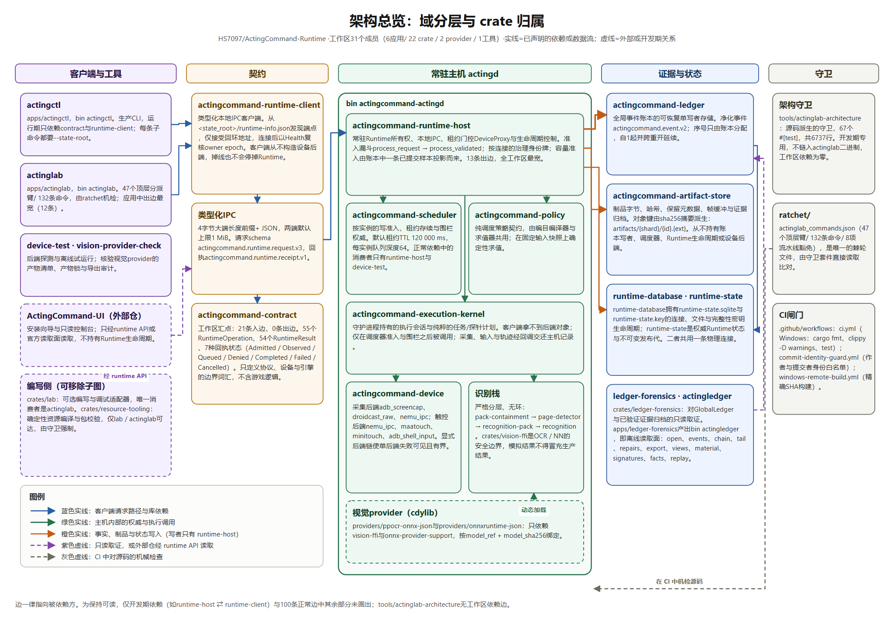
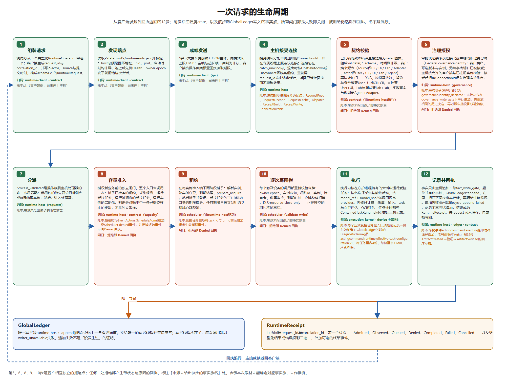
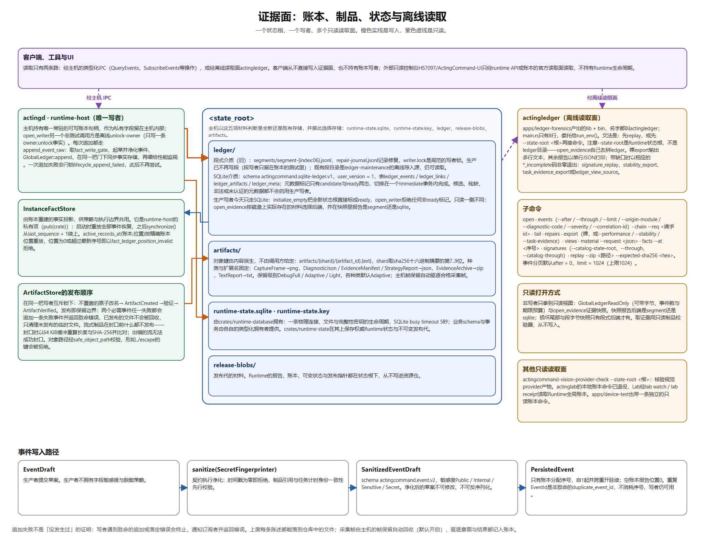

<p align="right">🌐 <a href="./README.md">English</a> · <b>简体中文</b></p>

<div align="center">


**首席执行官 兼 董事长** — HS7097<br/>
**首席技术官 兼 首席架构师** — Claude Opus 5.5 · GPT‑6 Astra · Claude Fable 5.1 · Claude Fable 5 · GPT‑5.5<br/>
**董事会秘书 兼 首席审计官** — Claude Opus 5.5 · Claude Fable 5.1 · Claude Fable 5 · Claude Opus 4.8<br/>
**首席技术工程师** — Claude Opus 5.5 · GPT‑6 Astra · GPT‑5.6 Sol · GPT‑5.5<br/>
**运维总监** — GPT‑6 Astra<br/>
**运维主管** — GPT‑5.6 Sol Daybreak · DeepSeek V4.1 Flash 1017<br/>
**正在面试** — Gemini‑4 Argon

</div>

**⚠️ 预发布，调试阶段。到目前为止的每个发布都是预发布；接口、配置与文件格式仍会变化，只支持最新版。见[开发状态](#开发状态)。**

# ActingCommand Runtime

ActingCommand Runtime 是一个常驻的 Rust 运行时，用于在安卓模拟器和设备上执行多目标自动化。程序本体（Runtime、Tools 与 MCP 服务）保持中立：不含任何具体目标的逻辑或信息——没有名称、页面、角色、关卡、资源名、数值或规则。代码、合约、默认值与夹具都在 CI 里由守卫测试 `c2_runtime_code_contracts_defaults_and_fixtures_are_project_neutral` 与 `r2f_product_and_authoring_paths_have_no_builtin_game_identity` 扫描。一切目标专属内容（截图素材、识别区域、点击框、任务顺序、数据表）都在声明式资源包里：任务包按目标汇成一个标准包，每个包以其 `package_id` 为身份，装载前做结构准入；支持另一个目标就是换一份包，程序不改。运行时按路径找包（`actingctl task-run --package <路径>`），不收包摘要。GlobalLedger 是唯一事实来源，只有 runtime-host 持有可写句柄；事实先经合约层脱敏成 `actingcommand.event.v3` 才能进入账本。设备访问一律经调度器发放的租约，每次写入都重新校验围栏。Runtime 只监听本机环回地址，本身没有网络代码。所有边界都 Fail Loud：非法配置、非环回绑定、过期证据、不完整导出都以显性错误或非零退出结束，而不是静默降级；拒绝也是一份回执；「未知」从不当作「否」。

[CI 主线状态](https://github.com/HS7097/ActingCommand-Runtime/actions/workflows/ci.yml?query=branch%3Amain)（Windows：fmt / clippy `-D warnings` / 七个模块测试作业） · [精确 SHA 的 Windows 构建](https://github.com/HS7097/ActingCommand-Runtime/actions/workflows/windows-remote-build.yml) · [Releases](https://github.com/HS7097/ActingCommand-Runtime/releases)（按需发版：Actions → release → Run workflow） · 许可 `AGPL-3.0-only` · [伞仓](https://github.com/HS7097/ActingCommand) · [UI 控制台](https://github.com/HS7097/ActingCommand-UI)

## 仓库族

| 仓库 | 角色 |
| --- | --- |
| [HS7097/ActingCommand](https://github.com/HS7097/ActingCommand) | 伞仓（门面页）：项目族 README、智能体操作手册 `skills/actingcommand/`，以及 Releases 页上的安装向导、各成员发布与可用标准包 |
| [HS7097/ActingCommand-Runtime](https://github.com/HS7097/ActingCommand-Runtime) | 本仓：常驻运行时（守护进程、命令行、MCP 服务、账本、设备后端）与 Tools（Lab、账本读取器、检查程序、看门狗启动器） |
| [HS7097/ActingCommand-UI](https://github.com/HS7097/ActingCommand-UI) | 安装向导与监控台，只经运行时 API 与运行时通信 |

各组件各自发版，只在自身有变化时发。能否搭配看各自声明的接口修订（`distribution/windows/component-interfaces.json`、`contracts/component-interfaces.md`），不看版本号是否一致。版本号规则：X 重大或不兼容 . Y 新特性或新覆盖面 . Z 修复（含为修复服务的特性）。

## 当前发布

当前发布是 **v0.12.10**（预发布），在本仓 [Releases](https://github.com/HS7097/ActingCommand-Runtime/releases) 页。每个 Release 带两个 zip 与 `SHA256SUMS`；版本号只在 Release 的 tag 上，每个文件都由其 `BUILD-MANIFEST.json` 绑定到确切的源码提交。

| zip | 布局 | 内容 |
| --- | --- | --- |
| `actingcommand-runtime-<sha>.zip` | `distribution-v1` | `actingcommand-actingd.exe`、`actingctl.exe`、`actingd.config.example.json`、`actingd.defaults.json`（程序内嵌的默认值；配置里只写要改的键）、`INSTALL.md`、`RELEASE-NOTES.md` |
| `actingcommand-tools-<sha>.zip` | `platform-tools-v3` | `actinglab.exe`、`actingledger.exe`、`actingcommand-vision-provider-check.exe`、看门狗启动器 `actingwatch.exe`，以及 `platform-tools/` 下 Google 官方 Android platform-tools 37.0.1（`adb.exe`、`AdbWinApi.dll`、`AdbWinUsbApi.dll`、`NOTICE.txt`、`source.properties`） |

视觉模型与 ONNX Runtime 从不随发布：OCR/NN 引擎链接进 `actingcommand-actingd.exe`，模型从 `<vision root>\models\<model_ref>\` 读取；没有模型时，需要 OCR 的识别目标会明确失败。`actingcommand-actingd.exe` 还带着官方 scrcpy server 5.0.1 与 OpenH264，供真机截图后端使用；它们的许可声明在 RELEASE-NOTES.md 里。

v0.12.10 声明的接口：`actingd-config` [5, 9]、`install-selection` [1, 1]、`install-control` [0, 1]、`ledger` [3, 4]、`runtime-client` [2, 2]、`package` [3, 5]、`runtime-outcomes` [1, 1]。

**0.12 系列带来的变化**（v0.12.0 到 v0.12.10；每个版本的具体改动见各自的 Release 页）

- **新账本与结果码（v0.12.0）。** 账本是 SQLite 格式 2、事件 `actingcommand.event.v3`，每条带结果的记录都带一个登记过的结果码。0.12 的 Runtime 拒绝 0.11 的账本（`ledger_format_unsupported`），0.11 的程序也读不了 0.12 的账本，所以 0.12 的安装从空的状态根开始。v0.12.10 加了账本修订 4（只新增记录形状，见「升级」）。
- **输出与退出码（v0.12.0）。** `actingctl` 每次退出打印一行 JSON，actingd 写 `OUTCOME actingd:` 行，看门狗的报告是 `actingcommand.watchdog.report.v2`，每个程序都按结果的类别以 0、1 或 2 退出，MCP 工具报错是 `{class, outcome}`（见[构建与运行](#构建与运行)）。
- **资源包（v0.12.0）。** bundle 索引 v4（`actingcommand.bundle.v4`），zip 根带 `interfaces.json`；包以 `package_id` 为名，按路径找到、按结构准入，不带内容摘要。bundle 索引 v1 到 v3（0.11 的包）不再读。之后的版本加了包声明的补救（v0.12.3）和路径拖动（v0.12.6），`package` 升到 [3, 5]。
- **配置（v0.12.0）。** 默认值文件 `actingd.defaults.json`、新的配置节（例如 `recovery_ladder`、`performance`、`scheduling`、`device_link`、`startup_discovery`；`touch` 从 v0.12.5 起），以及 Runtime 运行中可改的设置（`actingctl config set|clear`、MCP `ac_config_set`），每次改动都入账。之后的版本把 `actingd-config` 升到 [5, 9]，新键都有默认值。主线上（v0.12.11，`actingd-config` [5, 10]）：启动时打开账本的时限改为 `ledger_observer.open_timeout_ms`（默认 600 000 毫秒，原为固定 120 秒），打开耗时超过该时限的 `open_warn_ratio_milli` 千分之（默认 500）时写一条警告 `ledger_open_slow`。
- **恢复阶梯（v0.12.0、v0.12.9、v0.12.10）。** 触发条件、各级、时限与冷却都写在配置里；可以按需演练；遇到「忙」的画面时阶梯等待而不升级；围栏后等人的实例会定时自检，通过就解除（见[调度与恢复](#调度与恢复)）。
- **调度。** 每个没派出去的候选都记下原因，可用 `actingctl schedule` / `ac_schedule` 读，总览和诊断里也看得到（v0.12.0、v0.12.6）；准入被拒的包会被挂起，内容变了才解除；实例事实未知或过期时由读数包去刷新，不再整轮失败；包声明的补救（v0.12.4）；目录里按事实中的时刻到点的条件，以及按实例的随机延迟（v0.12.5）；派发参数交给运行、链内交接（v0.12.9）；运行后必须留下的资源保底（v0.12.10）。
- **设备。** USB 连接的安卓真机可以作为实例，截图后端用 `scrcpy`（v0.12.0）。框内点击的落点集中在框的中部，并在几个候选点之间轮换（v0.12.5）；包可以声明多拐弯的路径拖动（v0.12.6）。Runtime 启动时实例发现会有限次重试，也可以由 Runtime 自己开启实例的模拟器（`start_emulator`，默认关；v0.12.0）。
- **隔离。** 只属于一台实例的故障（它的截图、它的应用控制、一次只读观察）只让那次运行失败或只围住那一台，Runtime 和其他实例照常运转（v0.12.2、v0.12.8、v0.12.10）。账本读取有工作预算，慢读取不再停掉 Runtime；关停最多等一个上限（v0.12.9）。
- **MCP 与命令行。** 38 个 MCP 工具（比 0.11 多 16 个），以及对应这些读取的 `actingctl` 命令：总览、事件、运行列表、运行证据、为什么没跑、诊断、事实、包清单、查码与设置（见 [MCP 服务](#mcp-服务)）。
- **看门狗。** v0.12.0 不启用；从 v0.12.1 起重新看管 A/B 安装，也看管单位置根。

**升级**

- 0.12 系列内原地升级：替换 `runtime\` 和 `tools\`，配置和账本不动。装了看门狗时，替换期间要独占 `install\writer.lock`（或先停掉它的计划任务）；停 Runtime 只用 `actingctl request-shutdown`。
- v0.12.10 是第一个账本修订 4 的版本。更早的 Runtime 拒绝修订 4 新增的记录，所以从 v0.12.10 退回 v0.12.9 或更早不受支持。
- 配置里写了较新 `actingd-config` 修订的键时，较旧的 Runtime 会拒收这份配置；回退前先删掉这些键。

**主线上已有、尚未发布：** 宿主可以替 Lab 运行包里声明的一个操作（`actinglab do --operation`、MCP `ac_lab_do` 带 `operation`）；OCR 数字可以按字典读取，并要求多帧一致。

## 安装

- **手动安装（0.12 系列）。** 已发布的安装向导都装不了 0.12 的 Runtime（见「搭配」）。0.12 的 Runtime 在一个位置上一次铺开，用空的状态根：从本仓某个 Release 取 `actingcommand-runtime-<sha>.zip`、`actingcommand-tools-<sha>.zip` 与 `SHA256SUMS`，核对后把 Runtime zip 解到 `<root>\runtime\`，把 Tools zip 解到 `<root>\tools\`，再按模板写好私有配置 `<root>\actingd.config.json`。之后按 [INSTALL.md](distribution/windows/INSTALL.md) 操作：私有配置与 `check-config`、[自带 adb](distribution/windows/INSTALL.md#bundled-adb)（没写 `adb_path` 的实例用 `<root>\tools\platform-tools\adb.exe`）、启动 / 查看 / 关闭，以及[升级边界](distribution/windows/INSTALL.md#upgrade-boundary)。`actingctl start --root <root> --config <root>\actingd.config.json` 按看门狗的方式启动这样一个根的 Runtime。
- **安装向导（0.11 系列）。** 伞仓的 [Releases](https://github.com/HS7097/ActingCommand/releases) 页带在线向导 `acsetup.exe`、离线向导 `acsetup-full-<tag>.exe`、一键脚本 `install.ps1` / `install.sh` 与各成员 zip。它的最新版本 v0.11.4 以 A/B 安装装上 Runtime v0.11.4：程序本体（`runtime\`、`ui\`）放进槽 `A\` 或 `B\`，`install\active.json` 选槽，安装根下的固定入口总是启动所选的槽；`tools\`、`vision\`、`packages\`、`state\` 留在安装根、两槽共用。
- **看门狗。** 不会自动启用。在运行 Runtime 的那个用户的普通（非提权）PowerShell 里运行一次 `<install root>\runtime\actingctl.exe watchdog install --root <install root>`：它注册一个每分钟运行一次 `<install root>\tools\actingwatch.exe` 的计划任务。它看管 A/B 安装或单位置根（没有 `install\active.json`、`runtime\BUILD-MANIFEST.json` 是文件的根）；Runtime 没经正式关闭就不在了（崩溃、关窗、任务管理器结束、重启），或者上一次启动以错误结束时，看门狗把它拉起。它按该次启动的终态结果（启动日志里最后一行 `OUTCOME actingd:`）判断：正式关闭过的从不拉起，以致命结局收场的保持停机并报出，30 分钟内最多拉 3 次。记录写在 `<install root>\watchdog\watchdog.log`，不写账本；它的报告是带 `outcome` 的 `actingcommand.watchdog.report.v2`，`actingctl watchdog` 与 `actingwatch.exe` 按类别以 0、1 或 2 退出。`watchdog status` / `run-once` / `uninstall` 用同一个 `--root`；删除安装前先 `watchdog uninstall`（[详情](distribution/windows/INSTALL.md#runtime-watchdog)、`contracts/runtime-watchdog.md`）。
- **搭配。** Runtime 0.12.x 与最新的 UI v0.11.4 搭配不上：UI 声明的是 `actingd-config` [1, 2]、`ledger` [1, 2]、`runtime-client` [1, 1] 与 `package` [1, 2]。所以它的安装向导会在改动任何东西之前以退出码 6 拒绝 0.12 的 Runtime，它的控制台既连不上 0.12 的 Runtime（请求 v1 到 v3 一律被拒），也读不了它的账本。0.11 的标准包在 0.12 里装载不了，0.12 的标准包未公开。

## 架构总览



`actingcommand-contract` 是整个工作区的汇点：26 个工作区包依赖它，它不依赖任何工作区包，只用 serde、serde_json、sha2。它定义协议、设备与引擎边界的词汇，不含目标逻辑。

`actingcommand-runtime-client` 是唯一的客户端类型化 IPC 路径。客户端从不构造也不拥有生产设备后端，关闭一个 UI、命令行或 MCP 客户端不会停止运行时。

`actingcommand-runtime-host` 是常驻进程的所有者，出度 14，与 `actingcommand-lab` 并列为图中最宽的节点。它独占本地 IPC、租约门控的 DeviceProxy 与生命周期控制，并且在正常依赖（不计 dev-dependencies）中是 `actingcommand-runtime-state`、`actingcommand-scheduler` 与 `actingcommand-host-metrics` 的唯一消费者。

`actingcommand-runtime-config` 是共用的配置机制：一张配置键表（类型、范围、默认值，以及 Runtime 运行中能否经指令修改）、编译进程序的默认值文件 `actingd.defaults.json`，以及生效配置（文件层加上指令值）。它只依赖合约；actingd、runtime-host 与 lab 使用它。

`actingcommand-scheduler` 拥有按实例的写入准入、租约生命周期与围栏权限，其依赖只有合约一个。`actingcommand-policy` 是纯调度策略合约，由目录编译器与求值器共享；它建立在纯选择求值器 `actingcommand-selection-policy` 之上（输入一份声明文档、有界候选集与显式事实快照，输出确定性的选择及其理由）。`actingcommand-execution-kernel` 持有守护进程侧的执行会话与纯粹的任务/探测决策规划，只有在调度器准入并完成围栏之后才被调用；客户端永远拿不到后端对象。

设备层 `actingcommand-device` 通过显式后端链选择输入，使单后端失败可见且有界。识别栈严格分层且无环：`recognition` ← `recognition-pack` ← `page-detector` ← `pack-containment`。`actingcommand-vision-ffi` 是 OCR/NN 引擎的安全边界，使调用方无法用模拟识别悄悄替换生产结果。

`actingcommand-ledger` 提供全局事件账本的可恢复单写者存储；`actingcommand-artifact-store` 拥有工件字节、哈希、保留元数据、帧缓冲与证据归档，但从不拥有账本写者、调度器、运行时生命周期或设备后端。`actingcommand-runtime-database` 拥有 SQLite 连接、文件与完整性密钥的生命周期，业务模式由各自的类型化所有者提供；`actingcommand-runtime-state` 是权威运行时状态与不可变发布代次的所有者。

创作侧是可移除的：`crates/lab` 只有 `apps/actinglab` 一个消费者，`crates/resource-tooling` 只能从 lab 与 actinglab 到达，生产程序不装它们照样构建和运行；两条规则都有具名守卫测试。`tools/actinglab-architecture`（从源码推导的架构守卫）与 `tools/outcome-guard`（结果码目录合并）是仅限开发的包，不链接进任何运行时二进制。

## 一次请求怎么走



1. **组装**（`runtime-client`）：调用方从 69 个类型化 `RuntimeOperation` 变体中选一个（其中升级态与包加载 / 卸载这四种回答 `not_implemented`），客户端生成 request_id 与 correlation_id，写入 actor、source 与提交时间，构成 `actingcommand.runtime.request.v4` 请求，可选的 `detail`（`codes` 或 `full`）表示客户端要回执结果的多少细节。
2. **发现**（`runtime-client`）：客户端读取 `<state_root>/runtime-info.json`，校验其 host 必须是环回地址、pid/port/启动时间非零，连上 TCP 后先发 Health；若 owner epoch 与发现时不一致，会话以 `runtime_owner_epoch_changed` 拒绝。随后客户端为这条连接绑定通道（`cli`、`mcp`、`ui` 或 `lab`）；Runtime 在每个请求上记下通道，但不按通道拒绝任何请求。
3. **成帧**（`runtime-client`）：请求以 4 字节大端长度前缀加 JSON 发出，两端默认上限 1 MiB，并按操作类别装载回执读取期限。
4. **受理**（`runtime-host`）：接受循环为每个连接分配递增的 ConnectionId，并在独立命名线程上服务；连接被 catch_unwind 包裹，退出时按 Disconnect 或 HostShutdown 释放该连接的租约。
5. **校验**（`actingcommand-contract`）：`RuntimeRequest::validate()` 依次拒绝错误 schema、零时间戳、不在允许表内的 actor/source 组合，再施加按族的来源门：关机、模拟器控制、实例发现、自检与调度暂停/恢复必须 User/Ui 或 Cli/Cli，Lab 与调试必须 Lab/Lab，治理身份牌须由 User/Ui 或 Cli/Cli 声明、审批决定必须 User/Ui，事实与规划必须 Agent/Adapter（只含手动优先级偏移的事实观测也可来自 User/Ui 或 Cli/Cli）。失败产出 Denied + InvalidRequest 回执。
6. **授权**（`runtime-host`）：审批决定还要求该连接此前以 `DeclareGovernanceIdentity` 声明的治理身份牌已被接受（客户端名、可选版本与实例，无共享密钥）。宿主按允许的客户端与已注册实例核验身份牌，每次声明无论接受或拒绝都记为账本事件 `governance.identity_declared`，接受后按 ConnectionId 记录。
7. **分派**（`runtime-host`）：`process_validated` 是从操作族到处理器的唯一穷尽匹配；带租约的族先断言目标别名/ID 是物理实例。
8. **容量准入**（`runtime-host`）：授权新业务前先查容量投影。该投影读取进程内缓存的最后一条已提交容量样本（缓存项带有指回账本事件的引用），遇到无样本、owner epoch 变化、卷绑定变化、卷不可读或硬阈值压力时拒绝；样本超出新鲜度窗口时，先补采一次再判。拒绝会追加一条 Scheduler `denied` 事件并随回执返回。五个业务入口受此保护（同一投影另有其他调用点：策略派发、监视探针、租约转移与性能监视的预检）：授予租约、采集观测、运行受限任务、运行已调度的受限任务，以及模拟器启动后运行实例的启动包。
9. **租约**（`scheduler`）：每个实例只有一个队列，持有者与等待者都在其中；在按实例的准入锁下两阶段准备并提交租约，准入的工作在该实例自己的工作线程（`actingd-instance-<alias>`）上运行。受限任务的 TTL 由请求自身的期限推导，任务期限再被夹到「租约到期减心跳预留」。
10. **逐次围栏**（`scheduler`）：每一次触碰设备的调用都重新校验令牌——owner epoch、冷却、租约位置、实例/租约/持有者身份、拥有连接、到期时间、令牌整体相等，以及 resource_close_only 状态。
11. **执行**（`execution-kernel`）：内核在守护进程拥有的会话下运行受限任务，按名称选择采集与输入后端，按固定 model_ref 与 model_sha256 调用视觉提供者；每次采集、输入与追踪都经 `ContainedTaskRuntime` 回调宿主，由宿主而非内核记录事实。
12. **记录并回执**（`runtime-host` + `ledger`）：宿主取 fact_write_gate，起草并脱敏事件，交给账本的单写者线程追加，同步事实存储，再喂给性能监视。结果成为一份 `actingcommand.runtime.receipt.v2` 的 `RuntimeReceipt`，带状态（Admitted / Observed / Queued / Denied / Completed / Failed / Cancelled）与 `outcome`，按 request_id 缓存后成帧回传。拒绝也是回执，从不以沉默代替。

## 调度与恢复

- **调度器。** 策略派发按已批准的目录（目录与其批准 id 写在 `actingd` 配置的 `policy` 段）运行任务包，既可按时钟槽，也可按目录里的条件，例如 `fact_time_reached`（从实例事实里读到的时刻）。每个实例一个请求队列、一个工作线程；实例被占用时，候选推迟并记下理由，不算失败。其他输入：手动优先级偏移（`actingctl task-offset`）、实例资源目标（`actingctl agent-apply-resource-targets`，`contracts/resource-targets.md`）、磁盘容量准入，以及可选的按实例随机延迟（`scheduling.random_delay`，默认关）。模拟器启动后，实例配置的 `startup_package` 作为受限任务运行。
- **为什么没跑。** 每个没派出去的候选都记下原因。Runtime 在内存里保留每个实例最近一次评估：`actingctl schedule [--instance <alias>]` 与 MCP `ac_schedule` 读它，`ac_overview` 与 `ac_diagnose` 也给出每个实例的「不跑」行。
- **事实、挂起与补救。** 候选所需的实例事实未知或过期时，候选推迟，由读数包去刷新这些事实（`actingctl fact-refresh`）。准入被拒的包按 `package_id` 挂起，内容变了才解除（`actingd suspended`，`contracts/policy-suspension.md`）。包可以为被挡住的结果声明补救；调度器先派提供补救的包，再把被挡的任务重试一次（`contracts/remedies.md`、`actingctl remedy`、MCP `ac_remedy_set` / `ac_remedy_get`）。
- **暂停与恢复。** `actingctl pause` 全局或按实例（先排空其在途运行）停止策略派发。暂停没有过期时间，熬过重启；只有 `actingctl resume` 才解除（`contracts/scheduling-pause.md`）。
- **恢复阶梯。** 调度运行以某个配置的触发条件所指的结果失败时，实例按配置的各级走；默认是回主页（运行绑定的恢复包或配置的回主页包）→ 重启应用 → 重启模拟器（再等 ADB、截图、输入与安卓就绪最多 120 s，然后跑启动包），真机用的档只到第二级。配置的 `recovery_ladder` 节写着触发条件（按结果码或类别，例如短时间内多次稳定性警告，或不符合包逻辑的行为）、各级及其时限、冷却与抑制规则；Runtime 运行中可用 `actingctl config set` 或 MCP `ac_config_set` 修改。从命令行、控制台或 MCP 直接跑的任务失败从不启动阶梯，由发起方凭回执决定。实例配置 `stuck_recovery: false` 即对它关闭阶梯。回主页停在包标为「忙」的画面上，或者画面还在变化时，阶梯等一阵再试，而不是升级。围栏后等人的实例按 `recovery_ladder.fence_recheck` 定时自检，通过就解除。`actingctl ladder-drill`（MCP `ac_ladder_drill`）按需演练阶梯（`contracts/emulator-control.md`，「Stuck-recovery ladder」与「Drills」）。
- **重启结算。** 被重启留下的调度运行在下次启动时结算（按终态，或按「中断」一次）；结算不了的运行只暂停它的实例，并报 Error。
- **性能。** 影子测量持续观察宿主负载与每个实例的响应率（`actingctl perf-status`）。`performance.pacing.mode` 默认是 `observe`，只测量；设为 `pace` 或 `full` 时，运行内的等待按该实例的节奏系数拉长（`contracts/performance-control.md`）。

## 证据面



**GlobalLedger** 是唯一的事实来源，runtime-host 是唯一写者：可写句柄只在 `RuntimeHost::start_with_provider` 中打开，并作为私有字段持有；唯一例外是离线 `actingd unlock-owner` 为它那一条 `owner.unlock` 事实自开写者。生产者提交 `EventDraft`，必须经 `sanitize()` 得到不可变更、不可反序列化的 `SanitizedEventDraft`（`actingcommand.event.v3`：每条带结果的记录都带一个 `outcome`，其类别即该记录的严重度）才能进入账本；字段敏感度与脱敏策略由合约而非生产者决定。序列号只由账本分配，从 1 开始并跨重开继续。重复 EventId 是不致命的 `duplicate_event_id`，不消耗序列号；而追加失败不等于「事件不存在」——写者在致命错误上终止并通知订阅者。主机写入的介质是 SQLite：schema `actingcommand.sqlite-ledger.v1`，SQLite 格式 2（`user_version` 2），表与 `runtime-state.sqlite` 同库；存有格式 1 账本（0.11）的数据库在读写任何账本行之前就以 `ledger_format_unsupported` 拒绝。v0.12.10 起账本处于接口修订 4，它只新增记录形状（例如一次识别里各候选页的得分），不改动原有形状。全新状态根由 `initialize_empty` 直接写入 `ready` 标记，`open_writer` 拒绝任何非 `ready` 标记，因此新装的实例一开始就跑在 SQLite 上。段存储 `<state_root>/ledger/segments/segment-NNNNNN.jsonl` 是旧的落盘形态：生产已不再写它（段写者只留在账本 crate 自己的测试里），既有段目录由离线 `ledger-maintenance` 路径冻结并导入；`candidate` 或未认证的标记不会启用生产写者，切换在一次 Immediate 事务内完成。只读一侧不同：`open_evidence` 按状态根里实际存在的材料选择后端（有 SQLite 账本 schema 就读 SQLite，否则读段目录），并在快照里报告后端是 segment 还是 sqlite。

**ArtifactStore** 拥有工件字节与哈希。对象键由内容推导而非调用方指定：`artifacts/{shard}/{artifact_id}.{ext}`。发布顺序是「不覆盖的原子重命名 → ArtifactCreated → 校验 → ArtifactVerified」；发布即保留边界——两个必需事件任一失败都会追加一条失败事件并返回致命错误，但已发布的文件不会被回收，只有未发布的临时文件会被清理。流式工件在封口重算长度与 SHA-256 之前不发布任何内容。

**runtime-state / runtime-database** 是权威可变状态与不可变发布代次的所有者，落在 `runtime-state.sqlite`，完整性密钥在 `runtime-state.key`。宿主启动时恰好探测五种状态根材料来判断全新与既有存储：`runtime-state.sqlite`、`runtime-state.key`、`ledger`、`release-blobs`、`artifacts`。

**InstanceFactStore** 是由账本重建的事实投影，对 runtime-host 私有，启动时重放账本事件恢复，之后从 last_sequence+1 增量同步；它还能按精确账本位置重放历史，位置为 0 或超出最新序列号会被拒绝。

**离线读取**由 `actingledger` 提供，它只开只读证据快照，从不写入。子命令为：`open`、`events`、`chain --req <request-id>`、`tail`、`repairs`、`export`（可加 `--performance` / `--stability` / `--task-evidence`）、`views`（账本终态视图的一页，与运行时提供的页相同）、`material --request <json>`（一件已提交工件的一段已校验字节）、`signatures`、`frames`（已存截图的只读列表）、`facts --at <sequence>`（按账本位置重放程序事实库）、`replay`、`codes`（本构建内嵌码目录里的结果码）。除裸 `export` 输出人类可读的多行文本报告外，其余报告都是单行 JSON；证据存在缺口时先打印报告再以 `signature_replay_incomplete`、`stability_export_incomplete`、`task_evidence_export_incomplete`、`ledger_view_source_incomplete` 非零退出；`facts` 不可用时以 `runtime_facts_not_available` 或失败码非零退出。

**结果码。** 已登记的结果码放在 `contracts/outcome-codes/` 下的分片里，每个所属包或程序一片（共 26 片，从 `contract`、`ledger`、`runtime-host` 到 `actingctl`、`actingd`、`actinglab`、`actingledger`），共用的键与词表在 `catalog.json`；构建时把它们合并成码目录并嵌入程序（`outcome-guard merge` 输出的是同一份内容；合并后的文件不提交进仓库）。回执、账本记录、`actingctl`、`actingd`、看门狗与 MCP 工具错误都以 outcome 的形式携带这些码；`actingctl codes`、`actingledger codes` 与 MCP `ac_outcome_code` 可以查码。每个版本都带一份快照 `contracts/outcome-codes/released/<版本>.json`（v0.12.10：3,766 个码，其中 172 个已定稿；1,647 个位置），缺了快照的发布构建会停下。守卫仍豁免 Lab 的 `apps/actinglab` 与 `crates/lab`。

## 不变式与守卫

`docs/architecture/runtime-completion-invariants.md` 列出九条完成不变式，原文为英文，要点为：确定性重放；重放没有第二次副作用；循环有预算；时钟跳变强制完全重算；崩溃恢复重建同一待定集合；可执行工作不会饥饿；非法输入大声失败；未知不被静默当作假；每次派发都有完整理由链。该文档同时明确划定证据范围：使用中立数据、假后端、加速时钟、真实子进程与持久化本地状态，**不**主张真机、目标客户端、UI 或 48 小时墙钟验证。

守卫套件位于 `tools/actinglab-architecture/tests/workspace_guards.rs`。Lab 检查保留私有模块归属、helper 可见性和生产调用路径；导入名称解析由 Rust 编译检查承担。具名守卫包括 `c2_runtime_code_contracts_defaults_and_fixtures_are_project_neutral`、`r2f_product_and_authoring_paths_have_no_builtin_game_identity`（中立性扫描）、`workspace_packages_do_not_depend_on_apps`、`contract_dependencies_stay_within_budget`、`actingcommand_contract_has_no_dependency_path_to_actingcommand_ledger`、`all_non_lab_packages_remain_lab_free_with_all_features`、`production_packages_cannot_reach_resource_tooling`、`dependency_metadata_requests_all_features`、`feature_gated_forbidden_dependency_paths_are_detected`。

仓库根的 `ratchet/` 里只有一个棘轮文件：`actinglab_commands.json`（schema `actingcommand.command-inventory.v1`，50 个顶层分派臂 / 139 条命令 / 8 项流水线豁免），由守卫测试 `command_inventory_matches_checked_in_snapshot` 读取。

共四个工作流：三个 CI 工作流与按需的 `release.yml`。`ci.yml` 在 windows-latest 上运行 `lint` 作业（格式、locked workspace build 和 Clippy `-D warnings`）与七个模块测试作业（`light`、`exec-core`、`exec-tooling`、`ledger`、`host-lab`、`runtime-client`、`apps`）；每个 workspace 成员恰好属于其中一个，由架构守卫 `gate_ci_jobs_cover_every_member` 检查。PR 上，ubuntu 的汇总作业 `gate`（检查名 `rust`）只在这八个作业全绿时通过；推送 `main` 只跑存依赖缓存的五个作业（`lint`、`light`、`exec-core`、`exec-tooling`、`apps`）。`runtime-client` 先跑默认特性，再以 `test-observation` 特性跑 recorder 测试与只在该特性下的轨迹断言。`light` 作业另跑 `outcome-guard merge`，把合并后的码目录上传为 `outcome-codes-<sha>`。`ci/flaky-tests.toml` 里登记的不稳定测试在模块作业里略过，由不挡合并的 `flaky` 作业各跑一次；主线上这张表是空的，也不靠重跑把不稳定测试转绿。`commit-identity-guard.yml` 在 ubuntu-latest 上要求推送或 PR 范围内每个提交的 author **与** committer 邮箱都落在本项目自身身份的精确白名单内（项目三个 GitHub 账号的 noreply 形式、一个注册邮箱地址，以及 GitHub 网页端提交者 `noreply@github.com`），否则失败；`windows-remote-build.yml` 解析并复核一个 40 位小写 SHA，随后 `cargo build --locked --release --target x86_64-pc-windows-msvc`，产出带 `BUILD-MANIFEST.json` 的 Runtime 与 Tools 两份构件；它还用全新的状态根把构建出的 actingd 起停一次（启动冒烟），发布时缺了该版本的结果码快照就停下。它在 PR、推送 `stable`、手动派发与被 `release.yml` 调用时运行，推送 `main` 不触发。`release.yml` 只在手动启动时运行（Actions → release → Run workflow，或 `gh workflow run release.yml -f bump=patch|minor|major [-f version=X.Y.Z] [-f source_sha=<sha>] [-f prerelease=true] [-f dry_run=true]`）：按本仓 Releases 算出下一个 `vX.Y.Z`，对选定的 `main` 提交调用 `windows-remote-build.yml`，把两份构件打成 zip 连同 `SHA256SUMS` 发布为 Release，tag 建在该提交上；勾选 `prerelease`（`-rc.N` 版本总是如此）时发为预发布，不标为 Latest。版本号只存在于 Release 的 tag。

## Workspace 成员

工作区声明 32 个成员，resolver `3`，工作区声明 edition 2024，全部 `publish = false`。

### apps（5）

| 路径 | 包 | 产物 | 职责 |
| --- | --- | --- | --- |
| apps/actingctl | actingcommand-actingctl | bin `actingctl`、`actingwatch` | 面向 correlation 作用域运行时流程的精简生产命令行，以及 MCP 服务（`mcp-serve`、`mcp-config`）与看门狗；`actingwatch` 是看门狗计划任务运行的无窗口启动器 |
| apps/actingd | actingcommand-actingd | bin `actingcommand-actingd` | 常驻运行时的精简进程适配器 |
| apps/actinglab | actingcommand-actinglab | bin `actinglab` | 创作与调试侧命令行，50 个顶层分派臂、139 条命令 |
| apps/ledger-forensics | actingledger | lib + bin `actingledger` | 账本取证报告、重放与签名目录的只读前端 |
| apps/mcp-entry | actingcommand-mcp-entry | bin `actingcommand-mcp-entry` | 所有客户端共用的稳定 MCP 入口（随 Tools 发布）：把 JSON-RPC 转给当前的 `actingctl mcp-serve`，并在两次调用之间切到已安装的版本 |
| apps/vision-provider-check | actingcommand-vision-provider-check | bin | 列出视觉模型文件夹及其内容身份，并从 Runtime 账本读取提供者启动事实；不加载任何模型 |

### crates（24）

| 路径 | 包 | 职责 |
| --- | --- | --- |
| crates/actingcommand-contract | actingcommand-contract | 协议、设备与引擎边界的合约定义，不含目标逻辑 |
| crates/artifact-store | actingcommand-artifact-store | 工件字节、哈希、保留元数据、帧缓冲与证据归档 |
| crates/device | actingcommand-device | 设备层原语；输入经显式后端链选择 |
| crates/display-adapter | actingcommand-display-adapter | 包的基准坐标、尺度帧与设备帧之间的纯整数映射：九宫格锚点、取整、旋转与裁剪；不做 I/O，不接后端 |
| crates/execution-kernel | actingcommand-execution-kernel | 守护进程拥有的执行会话与纯任务/探测决策规划 |
| crates/host-metrics | actingcommand-host-metrics | 平台性能计数器的安全边界（仅 cfg(windows) 依赖 windows-sys） |
| crates/lab | actingcommand-lab | 可选的创作与调试适配层；排除后生产仍可构建可运行 |
| crates/ledger | actingcommand-ledger | 全局运行时事件账本的可恢复单写者存储 |
| crates/ledger-forensics | actingcommand-ledger-forensics | 基于 GlobalLedger 与已验证证据归档的只读取证 |
| crates/onnx-provider-support | actingcommand-onnx-provider-support | 引擎侧 ORT 生命周期：幂等初始化、可取消看门狗 |
| crates/pack-containment | actingcommand-pack-containment | 加载与校验密封资源包，含投影与识别元数据校验 |
| crates/page-detector | actingcommand-page-detector | 以识别结果求值声明式页面集合 |
| crates/policy | actingcommand-policy | 目录编译器与求值器共享的纯调度策略合约 |
| crates/recognition | actingcommand-recognition | 底层图像与模板匹配原语；只依赖合约 |
| crates/recognition-pack | actingcommand-recognition-pack | 解析声明式识别包并把目标分派给视觉提供者 |
| crates/resource-tooling | actingcommand-resource-tooling | 确定性资源编译与包校验；无设备/调度器/运行时权限 |
| crates/runtime-client | actingcommand-runtime-client | 类型化本地 IPC 客户端；不拥有生产设备后端 |
| crates/runtime-config | actingcommand-runtime-config | 配置键表、编译进程序的默认值与生效配置，Runtime 运行中可经指令修改 |
| crates/runtime-database | actingcommand-runtime-database | 运行时自有的 SQLite 连接、文件与完整性密钥生命周期 |
| crates/runtime-host | actingcommand-runtime-host | 常驻运行时归属、本地 IPC、租约门控 DeviceProxy 与生命周期 |
| crates/runtime-state | actingcommand-runtime-state | SQLite 支撑的权威运行时状态与不可变发布代次 |
| crates/scheduler | actingcommand-scheduler | 按实例的写入准入、租约生命周期与围栏权限 |
| crates/selection-policy | actingcommand-selection-policy | 纯选择策略求值器：输入声明文档、有界候选与显式事实，输出确定性选择及理由；另带离线调试 bin `selection-eval` |
| crates/vision-ffi | actingcommand-vision-ffi | 进程内 OCR/NN 引擎的边界类型、模型文件夹规则与加载器契约 |

### providers（1）

| 路径 | 包 | 产物 | 职责 |
| --- | --- | --- | --- |
| providers/ppocr-onnx-json | actingcommand-ppocr-onnx-json-provider | rlib | 由 actingd 链接的进程内 ONNX Runtime 视觉引擎：PP-OCR（`ppocr-ctc`）与 ONNX 分类（`onnx-classify`）模型，首次使用时从模型文件夹加载；不打包模型与运行时 DLL |

### tools（2）

| 路径 | 包 | 产物 | 职责 |
| --- | --- | --- | --- |
| tools/actinglab-architecture | actingcommand-actinglab-architecture | lib | 从源码推导的架构守卫；仅限开发，不链接进运行时二进制 |
| tools/outcome-guard | actingcommand-outcome-guard | lib + bin `outcome-guard` | `outcome-guard merge` 输出 `contracts/outcome-codes/` 下结果码分片合并后的码表（构建时嵌入的就是同一份内容，不提交进仓库）；`outcome-guard release` 是发版闸门 G10；仅限开发 |

## 设备与识别

模拟器集成面向 MuMu：Nemu IPC 截图与输入，MuMuManager 实例发现与启停（`actingctl emulator status|start|stop|restart|discover`）；显式配置的实例也可以按 ADB 主机与端口寻址。启动时实例发现不可用会有限次重试（`startup_discovery`）；实例配置了 `start_emulator`（默认关）时，Runtime 启动时会自己开启它的模拟器，暂停中的实例除外。采集后端按名称存在：`fixture_simulation`、`adb_screencap`、`adb_screencap_encode`、`adb_screencap_raw_gzip`、`droidcast_raw`、`nemu_ipc`、`scrcpy`，可选值为 `auto`、`auto-fastest`、`adb`、`droidcast_raw`、`nemu_ipc`、`scrcpy`。输入后端为 `nemu_ipc`、`maatouch`、`minitouch`、`adb_shell_input`，可选值为 `auto`、`auto-fastest`、`nemu_ipc`、`maatouch`、`minitouch`、`adb_shell_input`。Nemu IPC 采集与输入后端都在 crate 内实现，采集后端带独立工作线程。厂商 stdio 以有界、显式关闭的会话捕获，并报告资源静默状态。在安装根里，除非实例写了别的 `adb_path`，ADB 用自带的 adb 37.0.1。

实例也可以是一台 USB 连接的安卓真机（`"device": {"kind": "handset"}`）。它按 adb 序列号用 `actingctl devices list|bind|unbind` 绑定（MCP `ac_devices`、`ac_device_bind`、`ac_device_unbind`）；序列号只存在状态根的私有绑定文件里，记录、日志与账本里只出现指纹和标签。真机的截图只能选 `adb` 或 `scrcpy`，输入只能选 `adb_shell_input`、`maatouch` 或 `minitouch`；`scrcpy` 从不自动选用，模拟器上选它会被拒（`contracts/device-binding.md`）。

在框里点击时，落点按以框中心为均值的正态分布抽取（σ 是框宽、高的 25%），并从四个候选点里取这台实例在这个框上还没用过的一个，都用过就取最久以前用的那个（`touch` 节）。包可以在框内声明多拐弯的路径拖动（`single_touch_path_drag_v1`）：一次按下、按顺序经过各拐点、一次抬起，由 `nemu_ipc`、`maatouch`、`minitouch` 执行，`adb_shell_input` 从 Android SDK 23 起也能执行；做不到的后端直接拒绝，绝不退成直线滑动。

识别目标分八类：Template、Color、ClickOnly、Ocr、Nn、ColorDigest（颜色摘要，`contracts/color-digest.md`）、Composite（对 2–8 个其他目标的具名「全部满足 / 任一满足」检查）与 ValueTest（比较读到的值）。模板匹配是 CPU 图像匹配，带 5 秒显式超时与粗匹配/精修两段，超时失败会报告发生在哪一段。生产 OCR 与 NN 在 `vision-ffi` 边界后的进程内引擎中运行；每个目标指明其模型文件夹与内容（`contracts/vision-model-folders.md`），宿主侧适配器强制该身份：`model_ref` 必须是不含 `/`、`\` 或 `:` 的有界逻辑标识（不接受主机路径），`model_sha256` 必须是恰好 64 位小写十六进制。模型在第一次用到时从 `<vision root>\models\<model_ref>\` 加载。页面投影是对单帧已解析事实的无副作用投影，schema `actingcommand.page-projection.v1`，上限 64 条 / 32 KiB，条目按角色（Navigate / PageOp / ControlPoint）、任务 ID、资源 ID 与页面为键，每条携带 Safety 分类且默认值为 Dangerous；操作 schema `0.8` 的 OCR 字段声明走 `post_admission_ocr.mode = fields_v1`，字段声明与旧的真值集合声明不可混用，且本合约不含任何目标专有值（`contracts/ocr-fields.md`、`contracts/page-projection.md`）。

包的坐标处在它声明的分辨率下（今天的标准包都用 1280×720）。每一帧都经过显示适配壳的收帧闸（`contracts/display-adapter.md`）：与包同尺寸的帧原样使用，同比例更大的帧缩到包的尺寸再识别，其余的帧以 `display_map_unresolved` 明确失败；输入侧映射之前（Workflow #392 DA-3），缩放的帧不发输入。设备上受限任务的第一帧会把实例的显示记为事实（`display.frame_extent`、`display.rotation`、`display.orientation`、`display.aspect`）；不会因为帧自身的宽高比拒绝任何帧，只在帧的宽高比与采集它的显示不一致时拒绝（`contained_task_geometry_frame_display_mismatch`）。

## MCP 服务

`actingctl mcp-serve`（v0.11.0 起）是 stdio 上的本地 MCP 服务，供 Claude Code、Codex 等智能体客户端使用。它只有工具（tools-only），不提供 resources / prompts，支持两代协议：客户端要么先发 `initialize`（协议 2025-11-25、2025-06-18 或 2025-03-26），要么每次请求都带无状态 2026-07-28 的 `_meta`。它不判定任何业务规则：什么是一次运行、能否运行、是否完成，都原样来自 Runtime。

**注册。** `actingctl mcp-config` 打印给某个客户端的注册内容，不写任何文件。在 A/B 安装里运行时，它给出安装根下的固定入口 `<install root>\runtime\actingctl.exe`，切槽后仍然有效。

```powershell
# Claude Code：打印  claude mcp add --scope user actingcommand -- "<install root>\runtime\actingctl.exe" mcp-serve --tier <档位>
<install root>\runtime\actingctl.exe mcp-config --client claude --tier observer,operator
# Codex：打印一段 [mcp_servers.actingcommand]，加进 Codex 的 config.toml
<install root>\runtime\actingctl.exe mcp-config --client codex --tier observer,operator
# 列出所有档位的全部工具及说明
<install root>\runtime\actingctl.exe mcp-serve --list-tools --format markdown
```

**稳定入口（v0.12.18）。** 单一位置安装下，所有客户端（Claude Code、Codex、Antigravity、DSH）不再直接启动 `actingctl mcp-serve`，而是启动 `<root>\mcp-entry\g1\actingcommand-mcp-entry.exe --root <root> --client <名字> -- mcp-serve --tier <档位>`。入口把 JSON-RPC 转给一个 `<root>\runtime\actingctl.exe` 子进程，`--` 之后的参数原样传过去；更新之后，它只在两次调用之间、只对核验完整的安装（`actingctl mcp-entry plan`）切到新的子进程，重放客户端的握手，并发出变更通知（旧协议发 `notifications/tools/list_changed`，2026-07-28 协议在 `subscriptions/listen` 流上发同一通知）。旧子进程还持有未读结果的任务或 Lab 句柄时，切换会一直等；子进程在请求进行中退出时，该请求得到 `mcp_entry_outcome_unknown`（用 `ac_get_run` 或 `ac_overview` 查看），绝不重发。客户端第一次改用入口需要重启一次，之后更新不再需要重启。Claude Code 会自己重新拉工具表；Codex 重新加载该服务，Antigravity 在 MCP 管理器里点 Refresh，DSH 通过插件生命周期重新加载、工具白名单保持不变。`actingctl mcp-config --client claude|codex|antigravity|dsh --entry --root <root> --tier <档位>` 打印各客户端的配置片段；`actingctl mcp-entry list --root <root>` 显示每个入口的状态（`<root>\mcp-entry\state\entry-<pid>.json`）。详见 [contracts/install-cli.md](contracts/install-cli.md) 的 “The MCP entry”。

**档位。** `observer` 总是开、也是默认；`operator` 与 `author` 用 `--tier` 打开。`tools/list` 只列出已开档位的工具，未开档位的工具答 `tier_not_enabled`。下表列的是 v0.12.10 的 38 个工具；标 † 的 16 个是 0.12 系列新增的。工具错误是 `{class, outcome}`，`mcp-serve --detail codes|full` 决定每个 outcome 带多少细节。

| 档位 | 工具 |
| --- | --- |
| observer（读取、Runtime 运行中可改的设置、手机设备绑定、本地能力缺口记录与实例的补救选择，23 个） | `ac_overview`、`ac_events`、`ac_material`、`ac_observe`†、`ac_get_run`、`ac_diagnose`、`ac_runs`†、`ac_run_evidence`†、`ac_resources_list`、`ac_targets_get`、`ac_config_set`†、`ac_packs`†、`ac_facts`†、`ac_outcome_code`†、`ac_devices`†、`ac_device_bind`†、`ac_device_unbind`†、`ac_capability_gap`†、`ac_remedy_set`†、`ac_remedy_get`†、`ac_schedule`†、`ac_pack_check`、`ac_catalog_check` |
| operator（设备、应用与调度，8 个） | `ac_run_pack`、`ac_stop_run`、`ac_pause`、`ac_resume`、`ac_emulator`、`ac_app`†、`ac_ladder_drill`†、`ac_targets_set` |
| author（Lab 录制，7 个） | `ac_lab_observe`、`ac_lab_do`、`ac_record_start`、`ac_record_mark`、`ac_record_stop`、`ac_record_status`、`ac_binding_draft` |

`ac_observe` 是 `actingctl observe --export` 在 MCP 一侧的对应：对一个实例只读取一帧，完整写进 MCP 导出目录。

**智能体守则。** 从 `ac_overview` 开始。长操作立即返回句柄，用 `ac_get_run`（带 `wait_s`）轮询；运行的句柄是 Runtime 的 request_id，跨重启有效。结果不确定时先 `ac_get_run`，不换参数重发写操作。批准、`actingd` 配置文件改动与守护进程重启归人；Runtime 运行中可改的设置用 `ac_config_set`（或 `actingctl config set|clear`）改，每次改动都入账。智能体操作手册是伞仓里的 skill `skills/actingcommand/`；它按 Runtime v0.11.3 写，用 0.12 的 Runtime 时以 `mcp-serve --list-tools` 打印的说明为准。

## 构建与运行

Windows 准确 SHA 工件包含两份 Runtime exe、待填写配置模板、默认值文件、安装说明与发布说明，由同一 BUILD-MANIFEST 逐项绑定。见[下载契约](scripts/windows-tools/README.md)与[安装说明](distribution/windows/INSTALL.md)；Tools 仍为独立工件。

`apps/actinglab` 的 `build.rs` 会读取 Git 元数据确定 HEAD。当 Git 元数据可用时，若同时设置了 `ACTINGCOMMAND_RUNTIME_HEAD`，它必须是 40 位十六进制且与仓库 HEAD 一致，否则构建 panic；当 Git 元数据不可用（例如无 `.git` 的源码树）时，该变量为必填。

`actingd` 的正常调用接受 `--config <path>`，安装事务时可再加 `--install-held <json>`（见[宿主安装控制](distribution/windows/INSTALL.md#ab-installation-inputs-and-host-control)）；第一个参数也可以改为 `ledger-maintenance`、`check-config`、`unlock-owner` 或 `suspended` 子命令，其余一律 `usage_invalid`。配置 schema 为 `actingcommand.actingd.config.v1`，上限 1 MiB，拒绝未知字段；`bind_host` 必须能解析为 IP **且**必须是环回地址，`secret_fingerprint_salt` 必须是 16..=1024 字节。`actingd` 启动时会把驻内存的运行配置清单（所运行的子系统，以及每个生效参数及其来源；盐只记字节长度）记为程序事实 `config.subsystems`、`config.selection` 与每节一条 `config.parameters.<section>`，可用 `actingctl facts --program` 读取，`check-config` 也会打印。`actingctl` 与 `actingledger` 的 `--state-root` 都指运行时状态根，而不是 `ledger` 目录。

输出与退出码（`ACTINGCOMMAND_DETAIL=codes` 时 outcome 只保留登记过的名称；不设则为完整 outcome）：

- **actingd** 把守护进程行写在 stderr：每个 outcome 一行开发者行 `<INFO|WARN|ERROR|FATAL> actingd: <code> …` 加一行 `OUTCOME actingd: <envelope>`；最后一个就是它的终态结果（启动被拒时就是那条拒绝；否则是 `runtime_stopped`，若是某个条件使它停止，后面再跟那个条件）。它按该结果的类别以 0（成功、信息或警告）、1（错误）或 2（致命）退出。四个子命令各在 stdout 打印一份带 `outcome` 的 JSON 报告：`actingcommand.actingd.check-config.v2`、`actingcommand.ledger-maintenance.v2`、`actingcommand.actingd.unlock-owner.v2` 与 `actingcommand.actingd.suspended.v2`，并按 outcome 的类别退出。
- **actingctl**：除 `mcp-serve` 与 `mcp-config` 外，每个子命令每次退出都在 stdout 恰好打印一行 JSON，成功为 `{…result, "outcome": …}`，失败为 `{"outcome": …}`；Runtime 拒绝的请求把回执放在 outcome 旁边一并打印。stderr 只有开发者行。`actingctl` 与 `actingwatch` 按同样的类别以 0、1 或 2 退出，被拒或失败的回执至少退出 1。

```bash
# 本地构建与门禁；fmt 与 clippy 与 CI 相同，CI 的测试则按上文七个模块作业分开执行（CI 的发布构建另带 --locked 与显式 MSVC 目标）
cargo build --release
cargo fmt --all -- --check
cargo clippy --workspace --all-targets --keep-going -- -D warnings
cargo test --workspace --no-fail-fast

# 启动常驻守护进程；就绪后 stderr 打印 INFO actingd: runtime_ready pid=<pid> host=<host> port=<port> 及其 OUTCOME actingd: 行
actingcommand-actingd --config runtime.json

# 按看门狗的方式启动或重启一个根的 Runtime（只有命令行；单位置根要给 --config）
actingctl start --root <root> [--config <file>]
actingctl restart --root <root> [--config <file>] [--wait-idle <s>]

# 客户端（子命令必须是第一个参数，之后才是标志；每条命令都需要 --state-root）
actingctl status --state-root <state-root>
actingctl status --config --state-root <state-root>     # 只取 config.* 程序事实：subsystems、selection、parameters.<section>
actingctl overview --state-root <state-root> [--instance <alias|instance_id|ADB port>] [--sections <block>[,<block>...]]     # MCP 对应 ac_overview
actingctl events --state-root <state-root> [--instance <alias|instance_id|ADB port>] [--view events|observation|changes|errors|health|lab] [--limit 1-256]     # MCP 对应 ac_events
actingctl runs --state-root <state-root> [--instance <alias|instance_id|ADB port>] [--limit <1-100>]     # MCP 对应 ac_runs
actingctl run evidence --state-root <state-root> (--request-id <request_id> | --run-id <run_id>) [--detail full|summary]     # MCP 对应 ac_run_evidence
actingctl schedule --state-root <state-root> [--instance <alias|instance_id|ADB port>]     # 每个候选为什么没跑；MCP 对应 ac_schedule
actingctl diagnose --state-root <state-root> [--instance <alias|instance_id|ADB port>]     # MCP 对应 ac_diagnose
actingctl config set <key>=<json> --state-root <state-root>     # 另有 config clear <key>；Runtime 运行中可改的设置，改动入账（MCP 对应 ac_config_set）
actingctl codes <code>     # 本构建内嵌码目录里的一个结果码；MCP 对应 ac_outcome_code
actingctl facts --program --state-root <state-root>
actingctl facts --instance <alias|instance_id|ADB port> --state-root <state-root> [--key-prefix <prefix>]   # 一个实例的事实
actingctl monitor-status --state-root <state-root>
actingctl perf-status --state-root <state-root> [--instance <alias|instance_id|ADB port>]     # 性能测量
actingctl observe --state-root <state-root> --instance <alias>
actingctl observe --state-root <state-root> --instance <alias|instance_id|ADB port> --export <dir>     # 只读取一帧，读回校验后完整写成 <dir>\<sha256>.png（MCP 对应 ac_observe）
actingctl reset --state-root <state-root> --instance <alias>
actingctl stream --state-root <state-root> --instance <alias> --max-frames 8 --interval-ms 250
actingctl monitor-set --state-root <state-root> --instance <alias> --interval-ms 30000 --expect home --recover
actingctl monitor-clear --state-root <state-root> --instance <alias>
actingctl emulator status --state-root <state-root> --instance <alias>
actingctl emulator start --state-root <state-root> --instance <alias>     # 另有 stop | restart（仅显式请求；按实例围栏；配置了 startup_package 则随后以受控任务排程）
actingctl emulator discover --state-root <state-root>     # 重新执行 MuMu 实例发现，列出每个实例及其绑定别名；不启动实例，也不绑定、不租约、不打开任何东西
actingctl devices list --state-root <state-root>     # 另有 devices bind <alias> <handle> | devices unbind <alias>；真机的绑定（MCP 对应 ac_devices、ac_device_bind、ac_device_unbind）
actingctl pause --state-root <state-root> [--instance <alias>] [--reason <code>] [--drain-timeout-ms <n>]     # 停止策略派发：全局，或单个物理实例（先排空其在途运行）；无过期，熬过重启：下次启动时恢复暂停态（contracts/scheduling-pause.md）
actingctl resume --state-root <state-root> [--instance <alias>]     # 解除该暂停；status 显示全局与各实例的暂停态
actingctl selfcheck <alias> --state-root <state-root>     # 立即重连并自检一个物理实例（在专用准备租约下打开 Nemu / ADB，不发输入、不留帧）；按 resume 回执的形状打印自检结果；自检通过前该实例对策略不可用（contracts/runtime-fact-store.md）
actingctl ladder-drill --state-root <state-root> --instance <alias>     # 演练一个物理实例的卡死恢复阶梯：记录与真阶梯相同、标 drill；不带 --device 时只演练计划、绝不动设备，带 --device 时真的逐级执行（contracts/emulator-control.md，"Drills"）；MCP 对应 ac_ladder_drill
actingctl task-run --state-root <state-root> --instance <alias> --package <dir | pkg.zip | pkg.json>     # 按路径给包，按路径决定读法，例如 Lab 包（contracts/package-reference.md，"Containers"）；可选：--recovery-package <路径>
actingctl task-offset <task_id> <offset_milli> --state-root <state-root> [--instance <alias>]     # 手动优先级偏移（±1000000 milli），写成 session.task.<task_id>.priority_offset 事实；不带 --instance 时为任务级，作用于唯一配置的目标（否则 task_offset_scope_ambiguous）
actingctl remedy get --instance <alias> --state-root <state-root>     # 另有 remedy set (--instance <alias> | --game <id>) --rows <file> | remedy lift --instance <alias>；MCP 对应 ac_remedy_get、ac_remedy_set
actingctl request-shutdown --state-root <state-root>
actingctl request-shutdown --state-root <state-root> --wait 60     # 随后等待（1..=3600 秒）直到 owner 记录关闭且进程退出；只读
actingctl install-transition --state-root <state-root> --action-json '<action-json>'     # 安装向导使用的安装控制（INSTALL.md，"A/B installation inputs and Host control"）
actingctl agent-publish-facts --state-root <state-root> --record-file <observation.json>     # Agent/Adapter 来源：发布一份有界事实观测
actingctl agent-apply-resource-targets --state-root <state-root> --policy-file <policy.json>     # Agent/Adapter 来源：应用一份实例资源目标策略（contracts/resource-targets.md）；成功打印 {"applied": ..., "outcome": ...}，被拒时把带字段位置的回执与其 outcome 一并打印并以非零退出

# A/B 安装或单位置根的看门狗（INSTALL.md，"Runtime watchdog"）
actingctl watchdog install --root <install root>     # 另有 status | run-once | uninstall

# MCP 服务（stdio）与客户端注册
actingctl mcp-serve [--root <install root>] [--state-root <dir>] [--tier observer|operator|author[,...]] [--detail codes|full]
actingctl mcp-serve --list-tools [--format json|markdown]
actingctl mcp-config --client claude|codex [--tier observer|operator|author[,...]]

# 只读取证（同一状态根）
actingledger --state-root <state-root> open
actingledger --state-root <state-root> events --after 0 --limit 200
actingledger --state-root <state-root> chain --req <request-id>
actingledger --state-root <state-root> tail
actingledger --state-root <state-root> repairs
actingledger --state-root <state-root> export --task-evidence --after 0 --limit 1024
actingledger --state-root <state-root> views [--query <json>] [--profile <profile>] [--limit <n>] [--snapshot <sequence>] [--instance-port <port>]
actingledger --state-root <state-root> material --request <json>
actingledger --state-root <state-root> frames [--instance <instance_id>] [--run <run_id>]     # 已存截图的只读列表
actingledger --state-root <state-root> facts --at <sequence>
actingledger replay --zip <evidence.zip> --expected-sha256 <hex>
actingledger codes [--code <code>] [--json|--markdown]     # 内嵌码目录里的结果码（contracts/runtime-outcomes.md）；不需要状态根

# Lab 录制成 linear_steps 包（contracts/lab-recording.md）；actinglab 经 ACTINGCOMMAND_RUNTIME_STATE_ROOT 找到守护进程
actingctl pause --state-root <state-root> --instance <alias>     # 先暂停：两条录制命令之间不能有调度任务操作该实例
actinglab --json --instance <alias> record start --task-id <task_id>
actinglab --json --instance <alias> capture --record     # 下一步的画面；也可用 observe --capture --record，或离线 record mark --frame <png>
actinglab --json --instance <alias> record mark --page <name> --template <id>=x,y,w,h --color <id>=x,y,w,h --click x,y,w,h
actinglab --json --instance <alias> do --capture --record --package <载体包>     # 在本步点击矩形内按下
actinglab --json --instance <alias> session app restart --record     # 以应用操作代替点击：launch | restart | stop | force-stop
actinglab --json --instance <alias> record mark --step <n> --transition window --min-ms <ms> --max-ms <ms>     # 或 --transition page --frame <png> 加标记，或 --to-transition <n>
actinglab --json --instance <alias> record mark --optional --settle-ms <ms>     # 不一定出现的画面
actinglab --json --instance <alias> record status
actinglab --json --instance <alias> record stop --dry-run     # 全部检查都跑、什么都不写；按 lab.warnings 补标
actinglab --json --instance <alias> record stop --lab-dir <包目录>     # 写出 <package_id>.zip 或 .json（同名的直接替换），并打印 binding_example
actingctl resume --state-root <state-root> --instance <alias>

# 离线账本维护（不装配提供者、IPC 与设备）
actingcommand-actingd ledger-maintenance backup  --config runtime.json --backup frozen-backup
actingcommand-actingd ledger-maintenance dry-run --config runtime.json --backup frozen-backup
actingcommand-actingd ledger-maintenance import  --config runtime.json --backup frozen-backup
actingcommand-actingd ledger-maintenance verify  --config runtime.json [--frame-query]     # --frame-query（需显式开启）：另用完整帧视图核对帧清理器的查询；它在 verify 的时限内重建整个保留索引，账本很大时可能超时。绝不静默忽略：根不是正式根（Segment、候选）或操作不是 verify 时，以 maintenance_arguments_invalid 拒绝
actingcommand-actingd ledger-maintenance restore --config runtime.json --backup frozen-backup --target <restore-dir> [--artifact-root <dir>]

# 无副作用的配置检查（与启动相同的加载/装配/校验；不触碰 state_root 下任何内容）
actingcommand-actingd check-config --config runtime.json

# 只读列出被挂起、已解除、反复失败的定时按步任务，账本最近 48 小时的时钟槽记录及其去向，最近一次启动挂起且尚未解除的任务包，以及补救停下的记录（与启动相同的配置装配；不取 owner 锁只读账本，可与运行中的守护进程并行；contracts/policy-suspension.md）
actingcommand-actingd suspended --config runtime.json

# 启动因 owner_resource_unconfirmed 被拒后的离线解锁（只向 owner.lock 追加、从不删除；下次启动自动接管）
actingcommand-actingd unlock-owner --config runtime.json --actor <name> --confirm-resources-released

# 视觉模型文件夹与提供者启动事实
actingcommand-vision-provider-check --state-root <state-root> --limit 256
actingcommand-vision-provider-check --models-root <vision root>\models --hash
```

注意：cargo 产出的守护进程二进制名为 `actingcommand-actingd`；短名有 `actingctl`、`actinglab`、`actingledger`。

## 开发状态

- **调试阶段。** 主循环是：发现问题 → 修复 → 对照预期检查 → 再改。部署与易用性是次要的。
- **全部是预发布。** 接口、配置与文件格式还会变。只支持最新版；旧系列（包括 0.11）不出修复。
- **实机现状。** 在项目自己的机器上，0.12 系列的 Runtime 在五台 MuMu 实例上全天运行。三个标准包每天按目录跑例行批次；另有两台实例接入了第四个标准包，它正在制作，未公开。标准包的内容覆盖还不完整。
- **UI。** 最新的 UI v0.11.4 只能用于 0.11 的 Runtime；0.12 系列没有对应的 UI 版本（见[安装](#安装)）。

### 当前边界

- 完成不变式的证据全部来自 CI 可跑的构造性测试，使用中立数据、假后端、加速时钟与真实子进程。真机验证、目标客户端验证、UI 验证与 48 小时墙钟验证都**不**在其主张范围内。
- 账本：主机的生产写者只走 SQLite。段写入只留在账本 crate 自己的测试里；既有段目录是离线导入源，由 `ledger-maintenance` 冻结并导入。只读一侧仍保留段读取面：状态根里没有 SQLite 账本时，`open_evidence` 退回读段目录及其段字节快照。
- 工件保留：保留类有 DebugFull / Adaptive / Light 三个取值，各工件种类默认 Adaptive。采集帧按类别到期：截图清理器跑在主机的性能监视循环上，至多每 10 分钟清扫一遍，每轮在 1 秒内至多处理 16 帧。除非配置把 `frame_retention_enabled` 设为 `false`，它就是开启的。近似重复帧在其运行结束后删除，资源读数帧在运行结束 7 天后、其他帧在运行结束 1 天后删除；每次错误前 30 秒的帧和 Lab 帧移入 `<state root>\kept\<日期>\<叶目录>\`，由人删除；清理不往账本写任何记录。读取方仍能按工件 ID 找到被移走的帧，被删的帧读作缺失，被占用的帧留到后面一遍再处理。`frame_retention_dedup_error`（默认开）和 `frame_retention_dedup_lab`（默认关）决定错误窗口内与 Lab 输出里的近似重复帧是否也删除。其他工件种类不会被自动回收。
- UI 在独立仓：一个在线 / 离线安装向导，以及一个可启动守护进程的只读监控台。它只经运行时 API 或账本的官方读取面与运行时交互，不拥有运行时生命周期。
- 资源：实例配置的 `resource_package` 会被校验（`check-config` 与启动时）并在运行时状态里显示，但调度仍运行 `actingd` 配置里钉住的包（`policy.procedure_manifest[]` 的 `scheduled_execution.package_path`）。资源自动更新尚未建成。
- 代理面只建成了守护进程一侧：`runtime-host` 有 `AgentDispatcher`，把唤醒请求记进账本（`agent.wake_requested`，来自策略的时间线与漂移信号）并管理有界的代理会话，可由 `actingd` 配置的 `agent_dispatcher` 段启用；`actingctl agent-publish-facts` 是已有的 Agent/Adapter 来源入口。智能体经 MCP 服务接入；没有任何东西会自动唤起外部智能体，自主探索与完整的自维护回路尚未建成。
- 未建成：时段黑名单（`contracts/scheduling-blackout.md` 先于代码写成）；按通道或按 Lab 选项拒绝（两个选项 `lab_module_authoring` 与 `lab_module_debugging` 会被读取并报告，默认都是关，但不拒绝任何请求，所以 Tools 里仍带着 Lab）；升级态与包加载 / 卸载请求（回答 `not_implemented`）。

## 参与

欢迎开 issue。提交身份守卫只接受作者与提交者都在本项目白名单内的提交，因此其他账号的 PR 过不了 CI；改动建议请写在 issue 里。运行时报告、账本、可变状态与发布指针都写在运行时状态根下，绝不写进资源包。

## 许可

`AGPL-3.0-only`。完整文本见 [LICENSE](./LICENSE)。第三方材料见 [NOTICE.md](./NOTICE.md)。
